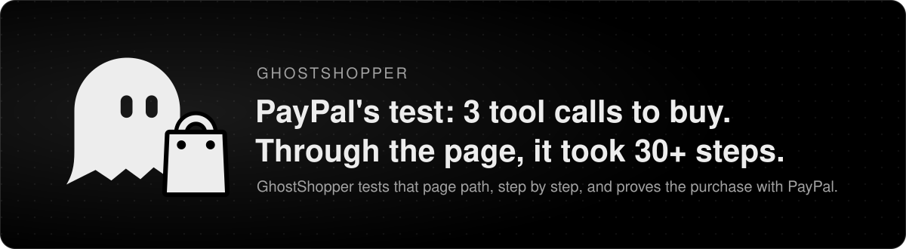
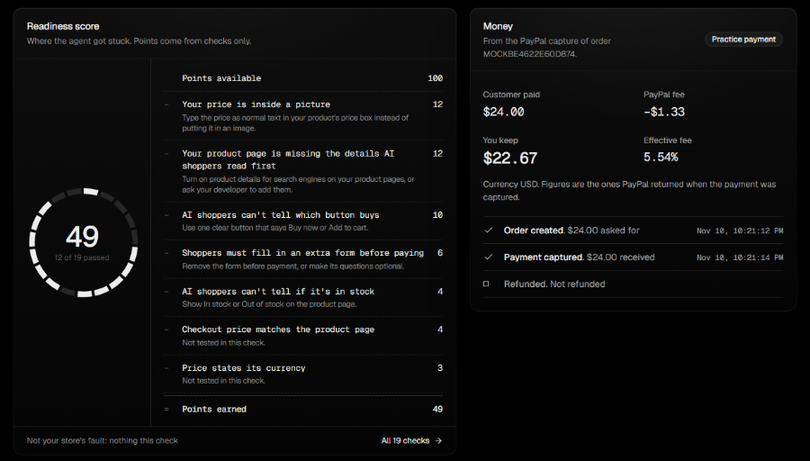
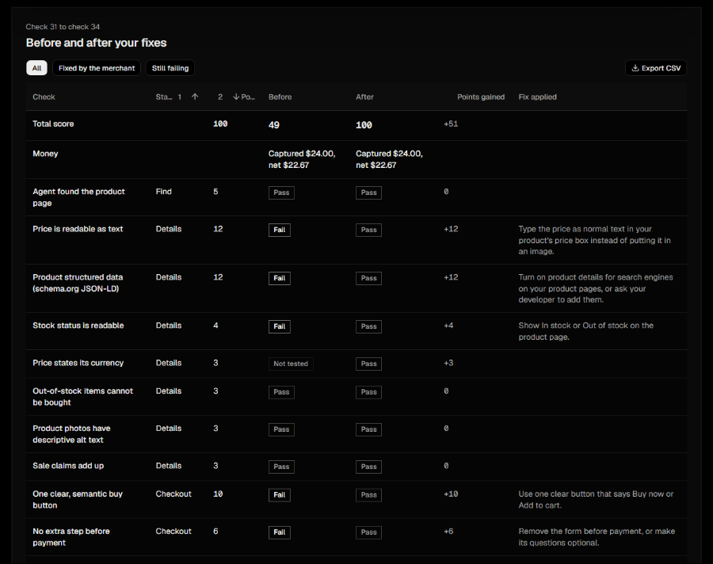
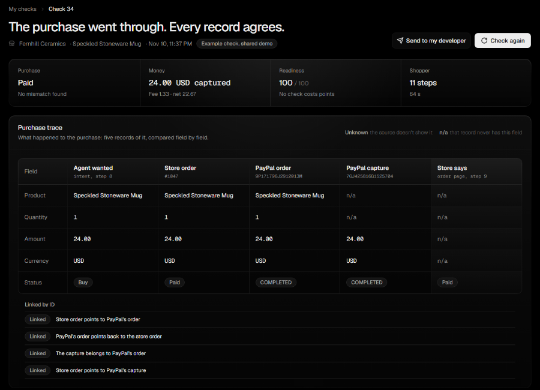

<div align="center">



<br>

**A mystery shopper for the AI agent era.** It shops your store like an AI agent, shows exactly where the purchase breaks, and proves the fixed checkout with a real PayPal Sandbox payment.

[Repository](https://github.com/tropicalbee/GhostShopper) · [Architecture](#how-it-works) · [Results](#results) · [Run it locally](#run-it-locally)
<!-- HOSTED_URL -->
<!-- VIDEO_URL -->

`Python 3.11` · `FastAPI` · `Playwright` · `React + Vite` · `AG Grid` · `PayPal Orders v2 + JS SDK v6` · `NVIDIA Nemotron` · `Kernel` · `Channel3`

</div>

---

## Contents

1. [Why this exists](#why-this-exists)
2. [What it does](#what-it-does)
3. [See it](#see-it)
4. [How it works](#how-it-works)
5. [Engineering](#engineering)
6. [Results](#results)
7. [Impact](#impact)
8. [Run it locally](#run-it-locally)
9. [Limits and FAQ](#limits-and-faq)
10. [Credits](#credits)

---

## Why this exists

PayPal measured it: an agent buys in **3 tool calls** when a store exposes checkout as agent tools (WebMCP). Most small stores don't, so the agent has to use the page, and that takes **30+ steps**. GhostShopper tests that page path, step by step.

It sends an AI shopper through the storefront, shows where the purchase breaks with evidence for each failure, then reruns the purchase through PayPal Sandbox and checks that the intended purchase, the PayPal order, the capture and the store's order all agree.

Traditional checkout tests verify known paths. GhostShopper tests what happens when an AI shopper has to find the product, read the page and complete the purchase without human intuition.

What stops an agent is often invisible to a person:

- a price drawn into an image
- missing product data (no `Product` JSON-LD)
- a "Go" button that is really a `<div>`
- a cookie banner sitting on the buy button
- an extra form before payment

And when the agent does pay, nobody checks that the store recorded the same purchase PayPal captured.

## What it does

| Step | What happens |
|---|---|
| **1. Shop** | An LLM driven agent browses the store, finds the product, reads the details and tries to check out. It picks every step itself. |
| **2. Diagnose** | Code checks every page the agent saw against 19 checks. Each failure comes with a screenshot and a fix in plain words. |
| **3. Pay** | The agent pays through the real PayPal Sandbox: JS SDK v6 button, buyer approval, Orders v2 capture. |
| **4. Verify** | The purchase trace compares five records of the same purchase and checks that they're linked by ID. |
| **5. Score** | A deterministic readiness score out of 100, fixes ranked by points, and a before/after comparison after the fixes. |

**What sets it apart is the purchase trace.** A payment can succeed while the store's order is wrong: captured but still pending, marked paid after a decline, duplicated on a retry. GhostShopper links the records by ID and flags each broken link. It caught all 33 trace scenarios in the benchmark. The score comes second, as a summary of the checks along the way.

On the demo store, the shopper hit five failures and scored 49. After the fixes, it completed the purchase through PayPal Sandbox: $24.00 captured, $22.67 net, matched to the store's order.

> **Positioning.** PayPal is building the infrastructure for agentic commerce through [Agent Ready](https://developer.paypal.com/agent-ready/overview) and [Store Sync](https://developer.paypal.com/store-sync/overview), two separate services under [Agentic Commerce Services](https://developer.paypal.com/agentic-commerce-services/about). GhostShopper helps a merchant diagnose their existing storefront and purchase flow before they pursue those integrations. The readiness score comes from GhostShopper's own checks. It is not a PayPal certification or an eligibility check, and it doesn't test WebMCP.

## See it

All three screenshots are from the live runs on 2026-11-11, on the demo store Fernhill Ceramics.

**Before: the flawed store scores 49/100.** Each lost point names the fix.



**After the fixes: 49 → 100, every fix accounted for.** Runs 31 and 34, both paid through the PayPal Sandbox.



**The proof: five records, one purchase, four ID links.** Run 34 on real Sandbox data. $24.00 captured, $1.33 fee, $22.67 net.



## How it works


The detailed version, with every file and twelve numbered steps, is in [docs/diagrams/architecture-detailed.png](docs/diagrams/architecture-detailed.png).

**One check, end to end**

1. The dashboard starts a check. The runs API prepares a browser and the model.
2. The shopper loop asks the model for the next tool: open a page, list elements, read text, click, fill, screenshot, pay.
3. The tool acts in the browser: local Playwright, or a Kernel cloud browser when hosted.
4. After every step, the check engine judges what the browser saw. No model is involved.
5. At checkout, the store creates its own order and a PayPal order. The buyer approves in PayPal's popup and the store captures.
6. The agent reads the store's order page back, and the trace compares all five records.

**The purchase trace**

| Record | Source |
|---|---|
| What the agent wanted | the run's target and the catalog price |
| The store's order | `store_orders`, page at `/store/orders/{n}` |
| PayPal's order | Orders v2 |
| PayPal's capture | Orders v2 capture, fees from `seller_receivable_breakdown` |
| What the store says afterwards | the order page, read back by code |

- Each record is compared on product, quantity, amount, currency and status.
- A value a source doesn't expose is marked **unknown**, with the reason, and is never guessed.
- Broken ID links sort before field mismatches. If the records belong to different purchases, comparing their fields means nothing.
- The trace is built by code in `backend/app/trace.py` and never changes the score.


## Engineering

### Design decisions

| Decision | Why |
|---|---|
| **A real tool-calling loop, not a script** | The model picks each action from what it saw. A loop detector warns on a repeated action and stops on the third. Runs are capped at 25 steps. |
| **A deterministic score** | Code records weighted checks, and the model never sees the weights. A changed score on a rerun means the store changed. |
| **Only the store's own failures cost points** | A declined card or a blocked popup is listed as "not the store's fault" and taken out of the denominator. |
| **Server-side pricing** | The PayPal order is priced from the catalog on the server, so a page can't talk the agent into a different amount. |
| **`custom_id` for the store order number** | `invoice_id` was rejected: PayPal refuses a repeated invoice id, and store numbers restart on a fresh deploy. |
| **Unknown over guessed** | A paid order with no PayPal reference makes the PayPal stages unknown and raises its own mismatch. |
| **Local Playwright, Kernel only when hosted** | Same tool interface for both. The test setup forces the local browser and blanks the paid keys. |
| **Any OpenAI-compatible model** | Set `LLM_PROVIDER` to `nvidia`, `groq`, `openai`, `ollama` and others with no code change. |

Full log: [docs/DECISIONS.md](docs/DECISIONS.md).

### Security and trust

The agent reads third-party pages and touches a payment flow, so every limit is enforced in code, not in the prompt.

- **Page content is data.** It reaches the model inside `<page_content>` tags. `agent/injection.py` scans visible and hidden text (display none, off-screen, aria-hidden, alt text, comments) and `robots.txt` for instructions aimed at agents, and logs every hit in the agent safety report.
- **Hard limits.** No navigation to another host and no downloads. Password and card fields are refused. Live store requests must go to public hosts, with DNS pinned.
- **Credentials.** The sandbox buyer login comes from `.env` and is never logged, stored or screenshotted.
- **Deployed mode.** Developer options are refused, and `/store/admin` is locked behind `DEMO_ADMIN_TOKEN` with an HMAC cookie.
- **Abuse limits.** Per-client rate limits read `X-Forwarded-For` from the right, plus daily caps on runs, market checks and PayPal orders. The Docker image runs as non-root.

### Supporting services

| Service | Role |
|---|---|
| **PayPal** | JS SDK v6 button on the store, Orders v2 create and capture, fees from the capture |
| **NVIDIA Nemotron** | The shopper's tool-calling model. Groq and others work through the same interface. |
| **Kernel** | Hosted cloud browser over CDP. Its live view lets a person finish PayPal's own checks. |
| **Channel3** | Market price context for the product, shown in the Advanced view. Never part of the score. |
| **AG Grid Community** | Before/after and check grids in the dashboard |

## Results

Every number links back to [docs/METRICS.md](docs/METRICS.md). Live evidence and mock benchmarks are kept apart.

### Live: NVIDIA Nemotron + PayPal Sandbox (2026-11-11)

| Run | Store | Score | Outcome |
|---|---|---|---|
| 31 | demo store, classic flaws on | **49/100** | purchased: $24.00 captured, $1.33 fee, $22.67 net |
| 32 | demo store, fixed | **100/100** | purchased |
| 34 | demo store, fixed | **100/100** | purchased as store order 1047, **all 4 ID links ok**, PayPal echoed `custom_id=1047` |
| 33 | public Shopify demo store, browse only | 62/100 | same 5 issues found locally |
| 37 | same Shopify store, in Kernel | 62/100 | same 5 issues in the cloud browser |

Runs 33 and 37 are a portability check on a store GhostShopper didn't build. They don't validate it on real stores.

### Benchmarks: mock PayPal, scripted navigator

These check the detectors and the trace against hand-written labels on the demo store. A perfect score here is a consistency check.

| Benchmark | Measures | Result |
|---|---|---|
| Purchase trace, 33 scenarios | first mismatch found, no false alarms, no guessing | **33/33** correct, 0 false mismatches on healthy runs, 5/5 broken links found |
| Flaw detection, 16 classic combinations | each check fires only when its flaw is on | precision 1.0, recall 1.0 (40 TP, 0 FP, 0 FN) |
| Flaw detection, 30 random combinations of 10 flaws | the same on a wider mix | precision 1.0, recall 1.0 (105 TP, 0 FP, 0 FN) |
| Full test suite | unit, API and browser e2e | **488 passed** |

### Reproduce them

```bash
python -m pytest                                              # full suite
python -m backend.app.eval benchmark --matrix trace           # purchase trace, 33 scenarios
python -m backend.app.eval benchmark --matrix classic         # flaw detection, 16 combinations
python -m backend.app.eval benchmark --matrix random --n 30 --seed 7
```

Run them with the virtualenv's Python: `.venv\Scripts\python` on Windows, `.venv/bin/python` on macOS and Linux. Browser tests skip if Chromium isn't installed.

## Impact

- **For small merchants.** A list of fixes in plain words, each with a screenshot of what the shopper saw, and a rerun that shows whether the fixes worked. No knowledge of structured data needed.
- **Catches two kinds of problems.** A store an agent can't use (prices in images, unclear buttons, blocked checkout), and a purchase whose records disagree (captured but pending, paid after a decline, duplicated on retry).
- **Why now.** As more purchases go through agents, a merchant needs to know whether an agent can buy from them before one tries. GhostShopper tests the page path that most small stores still depend on.
- **No revenue claims.** The 49 → 100 result is from the demo store, on the Sandbox.

## Run it locally

**You need:** Python 3.11+, Node 20+ (the Docker image uses Node 22) and git. No API keys are needed for mock mode.

<table>
<tr><th>Windows (PowerShell)</th><th>macOS / Linux</th></tr>
<tr><td>

```powershell
git clone https://github.com/tropicalbee/GhostShopper.git
cd GhostShopper
powershell -ExecutionPolicy Bypass -File scripts\setup.ps1
$env:PAYPAL_MODE="mock"
.venv\Scripts\python -m uvicorn backend.app.main:app --port 8000
```

</td><td>

```bash
git clone https://github.com/tropicalbee/GhostShopper.git
cd GhostShopper
bash scripts/setup.sh
PAYPAL_MODE=mock .venv/bin/python -m uvicorn \
  backend.app.main:app --port 8000
```

</td></tr>
</table>

The setup script creates `.venv`, installs the dependencies and Chromium inside it, builds the frontend, copies `.env.example` to `.env` and runs the tests.

| Open | URL |
|---|---|
| Dashboard | `http://localhost:8000/` |
| Demo store | `http://localhost:8000/store/` |
| Flaw toggles | `http://localhost:8000/store/admin` |
| Health and mode | `http://localhost:8000/api/health` |

**Try a before/after pair (second terminal, mock mode):**

```bash
python -m backend.app.seed --with-runs          # records a flawed run and a fixed run
python -m backend.app.agent.compare --last      # prints the score change
```

**Live run (needs the keys below):**

```bash
python -m backend.app.seed                                                    # demo state, classic flaws on
python -m backend.app.agent --llm live --flaws keep --checkout --paypal sandbox --headed
python -m backend.app.agent --llm live --flaws off --checkout --paypal sandbox --headed
python -m backend.app.agent.compare --last
```

On Windows, avoid `--reload` when starting runs from the dashboard. For frontend development, run `cd frontend && npm run dev` (it proxies `/api` and `/store` to port 8000).

<details>
<summary><b>Environment variables</b> (from <code>.env.example</code>)</summary>

| Variable | Needed for | Purpose |
|---|---|---|
| `PAYPAL_CLIENT_ID`, `PAYPAL_CLIENT_SECRET` | sandbox runs | Sandbox REST app, linked to a US business sandbox account |
| `PAYPAL_MODE` | optional | `sandbox` (default) or `mock` |
| `SANDBOX_BUYER_EMAIL`, `SANDBOX_BUYER_PASSWORD` | sandbox runs | The sandbox buyer the agent logs in as. Never logged or stored. |
| `LLM_PROVIDER`, `LLM_MODEL`, `LLM_API_KEY` | live model runs | For Nemotron: `nvidia`, a tool-calling Nemotron model id, a key from build.nvidia.com |
| `LLM_BASE_URL` | optional | Overrides the provider URL. Required for `openai-compatible`. |
| `GROQ_API_KEY`, `GROQ_MODEL` | optional | Older Groq settings |
| `BROWSER_PROVIDER`, `KERNEL_API_KEY` | hosted browser | `local` (default) or `kernel`. Kernel needs the store on a public URL. |
| `CHANNEL3_API_KEY` | optional | Live market check. Without it, recorded fixtures are used and labelled. |
| `DATABASE_PATH` | optional | SQLite file, default `data/ghostshopper.db` |
| `APP_BASE_URL` | optional | Public base URL, default `http://localhost:8000` |
| `PLAYWRIGHT_CHANNEL` | optional | Browser channel, such as `chromium` or `msedge` |
| `DEV_OPTIONS`, `DEMO_ADMIN_TOKEN` | optional | Developer options and the admin lock for deployed servers |
| `RETENTION_DAYS`, `TRUSTED_PROXY_HOPS` | optional | Data retention (default 30 days) and proxy hops (default 1) |
| `RUN_DAILY_CAP`, `MARKET_DAILY_CAP`, `ORDER_DAILY_CAP` | optional | Daily caps, defaults 40, 100 and 100 |

</details>

<details>
<summary><b>API</b></summary>

`POST /api/runs` · `GET /api/runs` · `GET /api/runs/{id}` · `GET /api/runs/{id}/compare` · `DELETE /api/runs/{id}` · `POST /api/runs/{id}/explain` · `GET /api/market/{sku}` · `GET /api/paypal/orders/{id}/verify`

Each browser sees only its own checks, plus the shared examples from the CLI and the seed command.

</details>

## Limits and FAQ

| Question | Answer |
|---|---|
| **Does it test WebMCP?** | No. Most small stores expose no agent tools yet, so agents use the page. GhostShopper tests that page path. See [PayPal's WebMCP post](https://developer.paypal.com/community/blog/WebMCP_PayPal_Agent_Ready). |
| **Is 100/100 a PayPal certification?** | No. It means GhostShopper's checks found nothing wrong. It is not an Agent Ready eligibility check. |
| **Does the full trace work on any store?** | Only on the demo store. Real stores don't expose their order records, so on a live store the store order shows as unknown. |
| **Is this real money?** | No. PayPal Sandbox only, and Sandbox behaviour is not production behaviour. |
| **Where does market data come from?** | Channel3. Without a key, recorded fixtures are used and labelled as sample data. |
| **Does the hosted version always have a browser?** | Hosted runs depend on the Kernel configuration and quota. |
| **Do the benchmarks prove it works on other stores?** | No. They compare the detectors with labels written for the demo store. The Shopify runs are the only check on a third-party store. |

## Credits

**Made by [tropicalbee](https://github.com/tropicalbee).** Product idea, system design, architecture decisions and validation: every live run, metric and claim in this README was checked by hand.

Coding buddy: [Claude](https://www.anthropic.com/claude) by Anthropic, who wrote the code to that design. Every change went through review before it landed.

Built for the PayPal AI Hackathon 2026, Nov 5 to 12. MIT licensed, see [LICENSE](LICENSE).

Docs: [PRD](docs/PRD.md) · [TRD](docs/TRD.md) · [Schema](docs/SCHEMA.md) · [App flow](docs/APPFLOW.md) · [Decisions](docs/DECISIONS.md) · [Metrics](docs/METRICS.md) · [Changelog](docs/CHANGELOG.md)
