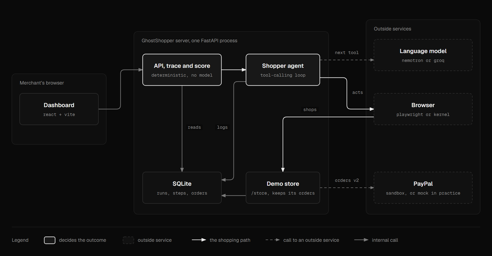
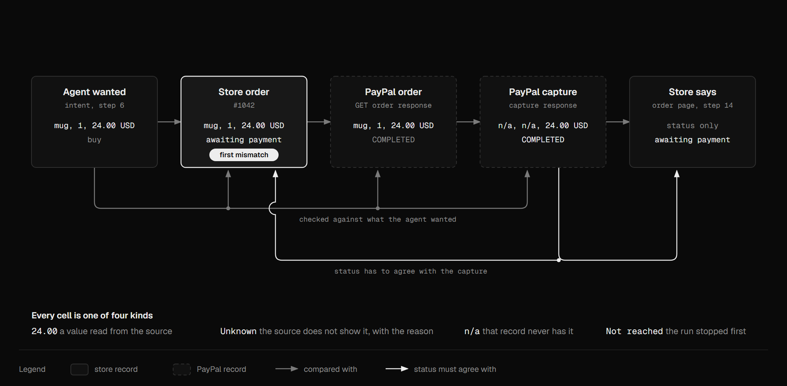

# GhostShopper

See your store through an AI shopper's eyes.

GhostShopper sends an AI mystery shopper through an online store. It tries to find a product, read the price and stock, and pay with PayPal, the way a shopping assistant would. Everywhere it gets stuck is logged with a screenshot, the element involved and the reason. The merchant gets a readiness score, a list of fixes ordered by how many points they're worth, and a before/after comparison once the fixes are in.

We built it for the PayPal AI Hackathon 2026. Hosted demo: (added after deploy)

## The problem

AI agents are starting to shop for people, and PayPal is preparing merchants for it with Agent Ready and Store Sync. Most small merchants have no idea whether an agent can actually use their store. The things that stop an agent are often invisible to a person: a price drawn into an image, missing product data, a "Go" button that is really a `<div>`, a cookie banner sitting on top of the buy button, an extra form before checkout.

## Who it's for

Small merchants running their own online store who want AI shoppers to be able to buy from them. They know their store well, but they don't know structured data or how agents behave. They need a score, a short list of fixes in plain words, and proof that the fixes worked.

## How it works

1. The mystery shopper is a real tool-calling loop. The LLM (NVIDIA Nemotron as the primary LLM, Groq also works) picks every step and uses browser tools: open a page, list elements, read text, click, fill a form, take a screenshot, pay with PayPal. The browser is local Playwright, or a Kernel cloud browser for hosted runs.
2. After every step, code reads the live page and records 18 checks across discovery, product details, checkout, payment and the outcome. The LLM never grades anything. Some examples: is the price readable as text, is there Product JSON-LD, is there a real buy button and is anything covering it, is there an extra form before payment, does the checkout price match the product page.
3. For the checkout test, the agent clicks the PayPal button (JS SDK v6), handles the popup, logs in as the sandbox buyer and approves. The store captures the payment through Orders v2. If PayPal asks for a CAPTCHA or an extra verification step, the agent doesn't touch it. The run pauses as "awaiting human approval" until a person finishes the PayPal window.
4. GhostShopper then checks that the order, the capture, the advertised price and PayPal's fees all line up, including the fee arithmetic.
5. The score (0 to 100) comes only from those checks. Only problems the store causes cost points. A declined card or a browser blocking the popup shows up separately as "not the store's fault", and the score is worked out over the points the store does control. Every failure maps to a specific fix; the LLM may reword the fix but can't change it.
6. Channel3 looks up similar products and tells you whether your price is competitive. It's for information only and doesn't affect the score.
7. You can compare any two runs: score change, failures fixed, failures still there.

The demo store, Fernhill Ceramics (`store/`), has 20 realistic flaws you can switch on and off, so the before/after demo is repeatable. Ten affect discovery and checkout, five affect the PayPal setup, four affect what the store does with the money, and one hides instructions for AI agents in the page.



A more detailed, numbered version is in [docs/diagrams/architecture-detailed.png](docs/diagrams/architecture-detailed.png).

## The purchase trace

A score tells you why the agent got stuck. It doesn't tell you whether the money and the order agree. After a payment attempt, GhostShopper compares five records of the same purchase, field by field (product, quantity, amount, currency, status):

1. What the agent wanted (the run's target and the catalog price).
2. The store's own order (the demo store keeps orders in `store_orders`, with a page at `/store/orders/{n}`).
3. PayPal's order.
4. PayPal's capture.
5. What the store's order page says afterwards. The agent reads that page back once payment is done.

The first record that disagrees is highlighted, with a plain explanation and a fix. A value a source doesn't expose is shown as unknown, with the reason, and never filled in. Live stores only get unknown for the store's order, because the shopper can't see it. The trace is built by code (`backend/app/trace.py`) and never changes the score.

Four store flaws exist to break the trace: `never_marks_paid`, `declined_marked_paid`, `success_after_cancel` and `duplicate_on_retry`. The mock PayPal has matching scenarios (`buyer_cancels`, `first_attempt_fails`), and the agent retries once on a temporary capture error.



## Safety

Store pages are untrusted. The shopper's system prompt frames page content as data, and `backend/app/agent/injection.py` flags text aimed at AI agents (hidden or visible). Hard limits stay in place whatever a page says: no other hosts, no downloads, no password or card fields. Each flagged passage is listed in the run's agent-safety report with where it was found, an excerpt and the step. The demo store has a `hidden_agent_instructions` flaw to show it. This report never changes the score either.

## Setup

You need Python 3.11+ and Node 20+.

```bash
# Windows
powershell -ExecutionPolicy Bypass -File scripts\setup.ps1
# macOS / Linux
bash scripts/setup.sh
```

The script creates `.venv`, installs the dependencies and Chromium inside `.venv`, builds the frontend, creates `.env` from `.env.example` if you don't have one yet, and runs the tests. Then fill in `.env`:

| Variable | What it's for |
|---|---|
| `PAYPAL_CLIENT_ID`, `PAYPAL_CLIENT_SECRET` | Sandbox checkout (developer.paypal.com > Apps & Credentials > Sandbox) |
| `SANDBOX_BUYER_EMAIL`, `SANDBOX_BUYER_PASSWORD` | The sandbox buyer the agent logs in as. Never logged, stored or screenshotted. |
| `LLM_PROVIDER`, `LLM_MODEL`, `LLM_API_KEY`, `LLM_BASE_URL` | The live LLM. For Nemotron set `LLM_PROVIDER=openai-compatible` and `LLM_BASE_URL=https://integrate.api.nvidia.com/v1` (see `.env.example`). Providers: `groq`, `openai`, `openrouter`, `together`, `ollama` (local, no key), `anthropic`, or `openai-compatible` with your own `LLM_BASE_URL`. The model must support tool calling. |
| `GROQ_API_KEY`, `GROQ_MODEL` | Optional Groq alternative. Still work as the live LLM when `LLM_PROVIDER` is empty or `groq`, e.g. `openai/gpt-oss-120b` or `llama-3.3-70b-versatile` |
| `KERNEL_API_KEY` and `BROWSER_PROVIDER=kernel` | Cloud browser. The store must be reachable on a public URL. |
| `CHANNEL3_API_KEY` | Live market check. Without it you get recorded fixtures, labelled as such. |

Everything also runs without keys, on mocks: `PAYPAL_MODE=mock` gives you a fake Orders API with a mock SDK and popup, and `--llm mock` replays recorded LLM responses. You always switch mocks on yourself, and `/api/health` shows which mode you're in.

## Run

```bash
.venv\Scripts\python -m uvicorn backend.app.main:app --port 8000       # dashboard at http://localhost:8000/ (after npm run build), store at /store/
.venv\Scripts\python -m backend.app.seed                               # demo state: the 4 classic flaws on

# bad store, then fixes, then rerun and compare
.venv\Scripts\python -m backend.app.agent --llm live --flaws keep --checkout --paypal sandbox --headed
.venv\Scripts\python -m backend.app.agent --llm live --flaws off  --checkout --paypal sandbox --headed
.venv\Scripts\python -m backend.app.agent.compare --last
```

Other commands:

- Reword a run's fixes: `python -m backend.app.agent.explain <run>`
- Market check: `python -m backend.app.market FH-MUG-01`
- Detection benchmark: `python -m backend.app.eval benchmark --matrix classic`
- API: `POST /api/runs`, `GET /api/runs`, `GET /api/runs/{id}`, `GET /api/runs/{id}/compare`, `DELETE /api/runs/{id}`, `POST /api/runs/{id}/explain`, `GET /api/market/{sku}`, `GET /api/paypal/orders/{id}/verify`. Each browser only sees its own checks plus the shared examples from the CLI and seed command.
- On a deployed server (`APP_BASE_URL` not localhost) the developer options on `POST /api/runs` are refused and `/store/admin` is locked. Set `DEMO_ADMIN_TOKEN`, open `/store/admin` and type it into the unlock form once to change the demo store's flaws. See `.env.example`.
- Mock demo without keys: `PAYPAL_MODE=mock`, then `.venv\Scripts\python -m backend.app.agent --llm mock --cassette day2_flaws_on --flaws on` (add `--checkout --paypal mock` to pay on the mock PayPal)
- Frontend dev server: `cd frontend && npm run dev` (proxies `/api` and `/store` to port 8000). Screens: landing (`#/`), new check, live check, results.
- Tests: `.venv\Scripts\python -m pytest` (browser tests skip if Chromium isn't installed)

## Tools we used, and how

| Tool | How we use it |
|---|---|
| PayPal JS SDK v6 | `<paypal-button>` on the demo store's checkout, with a one-time payment session (`presentationMode: "auto"`) |
| PayPal Orders v2 (sandbox) | Creating the order on the server (priced from the catalog, never by the browser) and capturing it; fees come from `seller_receivable_breakdown` |
| NVIDIA Nemotron (or another provider) | The shopper's tool-calling LLM, reached through an OpenAI-compatible endpoint (`https://integrate.api.nvidia.com/v1`). Groq and the other providers work by changing `LLM_PROVIDER`. It also rewords fixes and rates explanation quality, and none of that touches the score. |
| Kernel | Optional cloud browser over CDP. Its live view lets a person finish PayPal's own checks. |
| Channel3 | Product search for the market check |
| Playwright | Local browser automation behind the same tools as Kernel |
| FastAPI, SQLite, React + Vite + TS, AG Grid Community | API and storage, plus the dashboard (Day 5) |

## How we test the checks

A saboteur switches on combinations of flaws in the store. Each flaw is labelled with the checks it should trigger, and a scripted navigator walks the shopper through every combination. Precision and recall were both 1.0 on all 16 combinations of the original four flaws and on 30 random combinations of the first ten flaws (see `docs/METRICS.md`). The five newest flaws are labelled as triggering no scored check, since the trace and the safety report sit outside the score. That shows the detectors agree with our own labels on our own store. It doesn't yet say how they do on other stores; the details are in `docs/METRICS.md`.

## Built during the hackathon

We wrote everything in this repository during the PayPal AI Hackathon 2026 (Nov 5 to 12). The day-by-day log is in [docs/CHANGELOG.md](docs/CHANGELOG.md).

## License

MIT
