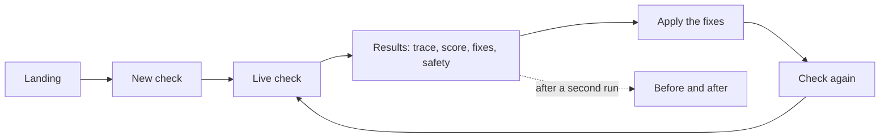
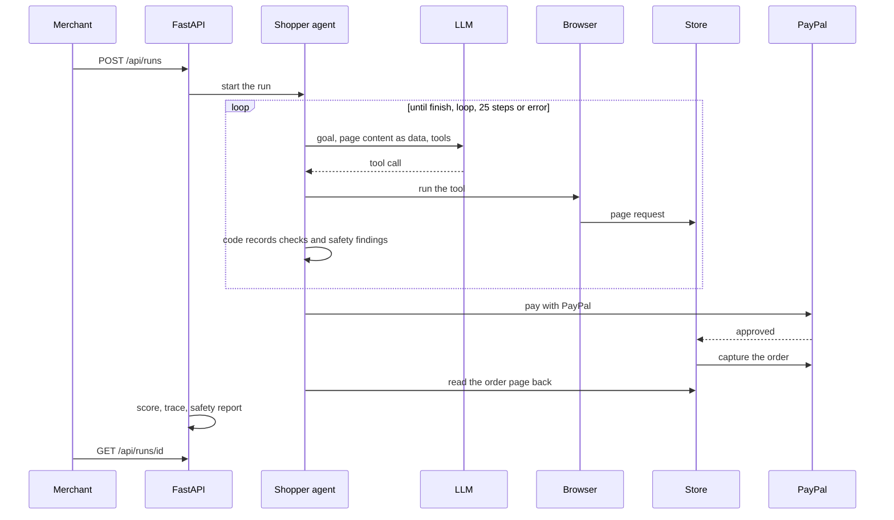

# App flow

## What the merchant does

1. Open the landing page at `#/` and press "Run a check on the demo store" or "Check your own store". The New check screen takes the store link.
2. The Live screen shows steps in plain words as they happen.
3. When the run ends, Results shows the purchase trace (five records, first mismatch highlighted), the score and sub-scores, the failures with their evidence, the fix list (most points first), the agent-safety panel, what wasn't the store's fault, the payment verification and the market check.
4. Apply the fixes. In the demo that means switching flaws off at `/store/admin` (open locally; on a deployed server, type the `DEMO_ADMIN_TOKEN` into the unlock form once).
5. Check again and open "See before and after": the score goes up, the failures go away, and the purchase is captured.

Diagrams as images: [architecture](diagrams/architecture.png), [detailed architecture](diagrams/architecture-detailed.png), [one check](diagrams/one-check.png), [trace](diagrams/trace.png).

Checks belong to the browser that started them (an httpOnly cookie, no accounts). "My checks" lists them, and nobody else can open them. Runs from the CLI or the seed command have no owner and are the shared examples everyone can read.

## One check, end to end

Image version: [one-check.png](diagrams/one-check.png).

## Manual checkout (Day 1)

Product page, then the details form (if `extra_checkout_step` is on), then checkout. The PayPal button opens the popup; the buyer logs in to the sandbox and approves. `onApprove` calls `POST /api/paypal/orders/{id}/capture`, and the thanks page shows the order and capture ids.

## The shopper loop (`backend/app/agent/loop.py`)

The LLM chooses every action. Code evaluates the checks, never the LLM.

1. Prepare (`service.py`). Check the LLM config (provider, key and model, or a cassette), the browser provider, the flaw selection, and for checkout runs the payment config. Anything missing is an error before a run row exists. Then set the flaws and save a snapshot of them.
2. Start the run: insert a `runs` row and open the browser (local Playwright, or Kernel over CDP).
3. Prompt the LLM with the rules and the goal: find the mug, read its price and stock, get to checkout, and in checkout runs pay with PayPal. A spending limit, if the user set one, is run config; the LLM does not enforce it.
3b. Page content is framed as data in the system prompt, with hard limits: no other hosts, no downloads, no password or card fields. `agent/injection.py` flags text aimed at AI agents and the findings go into `agent_safety` on the run. This never changes the score.
4. Call the LLM with the tools: `open_page`, `find_elements`, `read_text`, `click`, `fill_form`, `take_screenshot`, `finish`, plus `pay_with_paypal` in checkout runs (or `pay_with_saved_paypal` with `--payment vault`: no popup or password, the store creates and captures an order paid with the buyer's saved PayPal token). `click` refuses the PayPal button.
5. Run each tool call with a time limit (30 s, longer for paying), screenshot the page, and save a `steps` row. If the agent repeats the same action on the same page, it gets a warning the second time and the run stops the third time.
6. Detect (`engine.py`, `checks.py`). Collect facts from the DOM and record checks. On the product page: product_found and the eight product checks (price, currency, JSON-LD, stock, stock consistency, photo alt text, sale claims, buy button and whether it's covered). On checkout: checkout_reached, no_extra_steps and price_consistent. Every failed check gets a code, a cause, a full-page screenshot, a selector and a reason.
7. Add the observation to the conversation and go back to 4. Stop on `finish`, a loop, three timeouts in a row, 25 steps, or an error.
8. Finish. Decide the outcome from the checks, record task_completed, and mark the rest as not tested (or excluded, if something outside the store stopped the run). Compute and save the score.

## The WebMCP shopper loop (`backend/app/webmcp/shopper.py`)

Same purchase, other path. The LLM chooses every tool call. Code does the rest.

1. Prepare. Same config checks as the browser path. WebMCP payment runs only on the demo store and on PayPal's showcase (labelled an external demo). Other sites are discovery only.
2. Launch Chromium with `--enable-features=WebMCP` and open the store.
3. Discover. Read the tools through the CDP WebMCP domain. The shim is used only if the browser has no native WebMCP, and the report says which source it was.
4. Give the LLM the discovered tools plus `finish`. Tool names are mapped to names the LLM provider accepts (`shopping.searchProducts` becomes `shopping__searchProducts`).
5. The LLM searches, reads the product (`getProduct`) and calls `initiateCheckout`. Results reach the model inside `<tool_result>` tags, framed as data. The same injection scan applies.
6. When `initiateCheckout` returns an approval URL, the runtime takes over. It signs the sandbox buyer in to PayPal and approves, then tells the LLM the outcome. The LLM never sees credentials. If approval did not finish, the LLM is told not to complete the checkout.
7. The LLM calls `completeCheckout`. The runtime reads the store's order page back and records it as a step.
8. Finish on `finish`, a loop, or the step limit. Code decides the outcome from what the tools and PayPal returned, never from what the LLM claimed.
9. Build the trace (five records), the price consistency across search, product, checkout and capture, and the 8 tool checks. No readiness score.
10. `python -m backend.app.webmcp compare <browser_run> <webmcp_run>` or `GET /api/runs/{id}/compare-path` gives the side-by-side verdict.

## Paying (`agent/paypal_flow.py`)

1. The agent has to be on checkout. Wait for a visible `<paypal-button>`: paypal_button_found.
2. Click it and wait for the popup: popup_opened. If the browser blocked it, that's not the store's fault.
3. Screenshot the popup before typing anything. Then work through whatever PayPal shows: email and Next, password and Log In, then approve. Once the window closes, payment_approved.
4. If PayPal shows a CAPTCHA, a verification step or a form we don't recognize, stop and mark the run `awaiting_human`. A person completes the window, in a headed browser or through Kernel's live view, and the run picks up again when it closes. If nobody does it in time, payment_approved fails as not the store's fault. If PayPal shows its own error page, payment_approved ends at once with code paypal_error_page (not the store's fault).
5. Wait for the store's thanks page, an error, or a cancellation. A declined card is the buyer's side and is excluded; a capture error is the store's.
6. Confirm through `GET /api/paypal/orders/{id}` that the order and capture are COMPLETED, and link the order to the run: capture_completed.
7. Read the store's order page `/store/orders/{n}` back (`agent/order_page.py`) and record it as a step. The trace compares it with the other records.
8. Verify through `GET /api/paypal/orders/{id}/verify` that the order matches the advertised price, the capture matches the order, the currencies and capture ids match, and net = gross - fee: payment_verified.

Modes: with `PAYPAL_MODE=mock` the server serves a mock SDK and popup (using PayPal's element ids) and a fake Orders client. You pick a scenario with `PUT /mock-paypal/scenario`: `ok`, `no_button`, `popup_blocked`, `approval_stuck`, `capture_declined`, `captcha`, `verification_required`, `seller_login`, `capture_amount_mismatch`, `fee_mismatch`, `buyer_cancels` or `first_attempt_fails`. On a temporary capture error the agent retries once. `PAYPAL_MODE=sandbox` is the default and the real thing; it needs the PayPal and buyer credentials or the run won't start.

## Budget step (`agent/paypal_flow.py`)

When a run has a spending limit (`budget` on `POST /api/runs`, or `--budget`), code compares the checkout total with the limit after the agent reaches checkout and before it clicks the PayPal button. The LLM is not asked.

1. Total at or under the limit: pay as normal. After capture, `captured <= limit` is recorded in the verification evidence.
2. Total over the limit: record `over_budget` (not the store's fault), do not click the button, and no order is made.
3. Total can't be read while a limit is set: refuse to pay, so the agent never spends on a guess.

## After a run

- The purchase trace is on `GET /api/runs/{id}` as `trace`, built by `backend/app/trace.py`. It compares five records, marks the first mismatch and shows unknown, n/a or not reached where a source has nothing.

- Refund the test payment with `POST /api/paypal/orders/{id}/refund`. It refunds the whole capture, reads the refund back and checks status, amount and currency. Only the browser that owns the run can do it, and it is not part of the score.
- PayPal readiness is detected on every page the agent visits and shown next to the score as a separate figure.
- Download the product feed the agent could read with `GET /api/runs/{id}/feed.csv`.

- Reword the fixes with `POST /api/runs/{id}/explain` (LLM, text only; the deterministic fix stays next to it).
- Compare a check with the previous check of the same store from the same browser: `GET /api/runs/{id}/compare`. `GET /api/runs/compare?before=&after=` takes two of your own checks of the same store.
- Market check with `GET /api/market/{sku}` (Channel3, or recorded fixtures).
- Rate the explanations with `python -m backend.app.eval judge <run>` (a separate metric).
