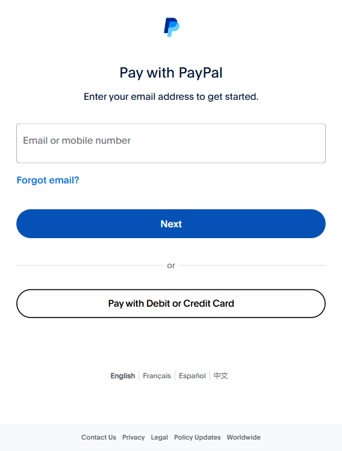
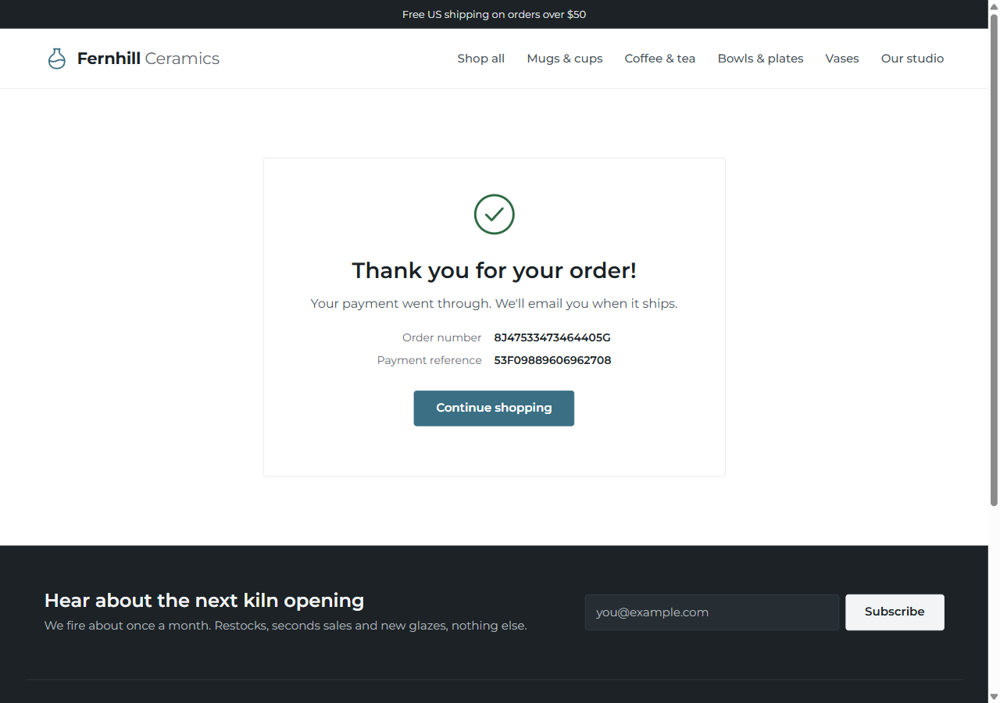

# Progress

## 2026-11-11, session 4 (live runs, ID links, Kernel fix, new logo)

### Done
- Live runs with real Nemotron and the real PayPal sandbox: bad store 49/100 and purchased (run 31), fixed store 100/100 (run 32), cassettes recorded. Run 34 after the ID-link change: 100/100, all four ID links ok on real sandbox data.
- Shopify demo store, browse only: 62/100 on 84 of 100 points, same 5 issues locally (run 33) and in Kernel (run 37).
- Trace: four ID link checks, `records_not_linked`, broken links first. A paid order with no PayPal id makes the PayPal stages unknown and raises `paid_without_paypal_reference`. Trace benchmark now 33/33.
- Store order is created before the PayPal order, its number goes to PayPal as `custom_id`, and the capture id is saved on it.
- Kernel fix: service workers blocked locally and bypassed in Kernel, request guard never raises, run limit 600 s, session always deleted.
- `LLM_PROVIDER=nvidia`, accurate "not tested" reasons, tests never use Kernel or paid keys from `.env`.
- Ledger shows matched for sandbox runs 18, 31, 32 and 34 after enabling Transaction search.
- Frontend: "Linked by ID" section, ghost with a shopping bag as logo and favicon, header buttons hide when the page shows the same ones, the ghost walks the landing page stepper to the first mismatch.
- Full suite 488 passed. Numbers in METRICS.md.

### Not verified
- The Linked by ID section has not been seen on screen with real data.
- A Kernel purchase on the hosted URL.
- The `test_trace_matrix` subset test failed twice under load, then passed in later full runs. Cause unknown.

### Next
1. Render deploy with Kernel as the hosted browser (`BROWSER_PROVIDER=kernel` on Render), a sandbox purchase on the hosted URL, hosted URL in the README.
2. README limitation wording: the full five stage trace works on the demo store only, real stores don't expose their order records yet. Carry it into Devpost and the video script. Humanizer pass.
3. Fresh-clone test.
4. Devpost text and video.
5. Optional: Channel3 key.

### Blockers
- None. Kernel credit left: 4.95 of 5.00 USD.

## 2026-11-10, part 3 (trace, safety guard, redesign built; docs updated)

### Done (in code and mock tests, not verified live)
- Purchase trace in `backend/app/trace.py`: five records, first mismatch, unknown / n/a / not reached. It never changes the score.
- The demo store keeps its own orders (`store/orders.py`, `store_orders`, order page `/store/orders/{n}`). The runtime reads the order page back after payment (`agent/order_page.py`).
- Four purchase flaws, mock scenarios `buyer_cancels` and `first_attempt_fails`, and one retry on a temporary capture error.
- Prompt-injection guard (`agent/injection.py`): page content framed as data, hard limits, `agent_safety` on the run, flaw `hidden_agent_instructions`. Never changes the score.
- Frontend redesign: Landing, New check, Live, Results with the trace and the safety panel.
- Diagrams in `docs/diagrams/`. README, PRD, APPFLOW, TRD, SCHEMA, PLAN and CHANGELOG updated.

### Not verified
- Live PayPal sandbox, a live model run (Nemotron or Groq) and a real Kernel run have not been done with the new code. No new test counts were recorded in METRICS.md for this part.

### Next
1. One live Nemotron run, bad store then fixed store, plus one sandbox purchase to see the trace on real data.
2. Shopify demo store live test.
3. Render deploy, hosted URL in the README, fresh-clone test.
4. Video and Devpost.

### Blockers
- Usage limits on the AI tooling, so live runs and the remaining work have to be kept small and done one at a time.

## 2026-11-10, part 2 (new direction and redesign, nothing built yet)

### Decided with the user
- New pitch: GhostShopper proves that the agent's intended purchase, the PayPal transaction and the store's own order all agree, and shows where they break. The readiness score stays, as the reason the agent got stuck.
- Results becomes a 5 stage purchase trace: agent wanted, store order, PayPal order, PayPal capture, store says. Each stage shows product, qty, amount, currency, status. The first mismatch is highlighted with its fix.
- New store flaws to add: buyer cancels but the store shows success, payment declined but the store marks it paid, captured but the store never marks it paid, duplicate order on retry. Price mismatch already exists (`price_mismatch`, `verification.py`). The store needs an order status the agent can read.
- UI redesign in a Stripe-dashboard style: light grey page, white panels, small clean type, aligned numbers, one blue accent, red only in small badges. This replaces the "Ledger" look (the user said the current screen hurts their eyes: full red hero box, giant headline, boxes in boxes). Also a proper landing page.
- Landing page main button: "Run a check on the demo store", second button "Check your own store".
- Process: show visual mockups (real HTML pages, screenshotted) of the landing page, Results and New check before any frontend code. The user can't read ASCII sketches. A cheaper model writes the production code; Opus reviews.
- Skipped: WebMCP, the PayPal Agent Toolkit.

### Open
- Figma MCP needs a login (`/mcp`, figma) before designs can come from Figma.
- Kernel bug: "Pay with the real PayPal sandbox" on Home asks for `KERNEL_API_KEY` even locally (`runs.py:136`, `agent/service.py:107`). Planned fix: web real runs pay with vault and use the local browser; Kernel only when hosted. Waiting on the error from `python -m backend.app.vault setup`.

### Next
1. Build the 3 mockups (landing, Results trace, New check) and show them.
2. After approval: trace + 4 flaws in the backend, then the frontend redesign.
3. Kernel/vault fix, one live Nemotron + sandbox run, Render deploy, video.

## 2026-11-10 (build check, interrupted fixes)

### Done
- `npm run build` passes. `test_ledger.py` and `test_compare.py`: 26 passed.
- Both fixes from yesterday turned out to be finished in the code. Checked them end to end against a scratch database with a fresh seeded pair:
  - The hero's stop rule picks `paypal_button_found` on the bad store, so it reads "stopped at checkout, before the PayPal button". The ambiguous buy button is skipped because later checks pass.
  - A second server process with empty memory shows the seeded capture as `matched` in `/api/ledger`. `sync_from_orders` rebuilds the mock reporting rows from SQLite, and only for MOCKCAP ids.
- No code changed this session.

### Not verified
- The new screens still have not been opened in a browser.

Full suite (user run): 361 passed, 1 warning.

### Next
1. User: commit (leave `design/` out).
2. User: enable "Save payment methods" and "Transaction search" on the sandbox app.
3. Live Nemotron run with `--payment vault`, then the video.

---

## 2026-11-09, part 2 (ledger, before/after, flow cards)

None of this is committed yet. Both agents were stopped partway through their last fix because the weekly usage limit ran out, so the first job tomorrow is to check the build.

### Done (reviewed and approved)
- Before/after grid (`CompareGrid.tsx`, `lib/compare.ts`) on Results: one row per check with bad store, fixed store and points gained, plus pinned score and money rows. `GET /api/runs/{id}/compare?before=` returns 404 `NO_EARLIER_CHECK` when there is no earlier check. AG Grid Community only.
- The seeded "before" run is now a real lost sale. `seed --with-runs` turns on the classic flaws plus `no_guest_checkout`. The seeded pair goes from a score of 24 to 100, and the money row reads "Lost $24.00", then "Captured $24.00, net $22.67". The demo commands the seed prints include `no_guest_checkout`.
- Shopper flow and money flow cards (`ShopperFlow.tsx`, `MoneyFlow.tsx`), styled after `design/razorpay_ref`, with no React Flow and no new dependencies. Only the real stop point is marked "Stopped here". Earlier failures show as "Got past". The stop rule lives in `bits.tsx` (`stopIndex`, `stopStage`).
- Agent sales ledger: `GET /api/ledger` (`backend/app/ledger.py`), the PayPal Transaction Search client (`search_transactions` in `paypal.py`) with a mock, and an AG Grid screen at `#/ledger` ("Sales ledger" in the nav). Each order is matched to PayPal reporting by capture id: matched, pending, mismatch or not_checked. It has a pinned totals row, preset filters and CSV export. `test_ledger.py`: 15 passed.

### Interrupted (may be half edited)
- The MoneyHero "why" line should name the check that ended the run, the account wall. Today it names the first failed check in the checkout stage, the ambiguous buy button. Target text: "...stopped at checkout, before the PayPal button. You lost $24.00." Files: `frontend/src/components/bits.tsx`, `MoneyHero.tsx`, `ShopperFlow.tsx`.
- Mock Transaction Search reads only in-memory captures. After a server restart, or for orders captured by the seed or the CLI, every row shows "pending". Fix: in mock mode, build the reporting rows from the captures in SQLite, for mock ids only. Files: `backend/app/paypal_mock.py`, `backend/app/ledger.py`, `backend/tests/test_ledger.py`.

### Not verified
- No new screen has been opened in a browser yet: the ledger, the before/after grid and the flow cards.
- The real sandbox Transaction Search call. Also open: whether the capture id equals `transaction_id`, and how long the reporting delay is.
- The full test suite has not been run since the ledger and flow work. The last full run was 341 passed, before that work.

### Next
1. `cd frontend; npm run build`, then `.venv\Scripts\python -m pytest`. Repair whatever the interrupted edits broke.
2. Finish the two interrupted fixes above.
3. Commit, leaving `design/` out.
4. User: enable "Save payment methods" and "Transaction search" on the sandbox app.
5. Live Nemotron run with `--payment vault`, then the video.

### Blockers
- Weekly usage limit. From now on, one agent at a time, and the user runs the full test suite.

---

## 2026-11-09 (money first, vault payment)

### Done
- The LLM's fill_form now refuses password fields on every store, not only live ones. Two tests. Committed.
- Docs now name NVIDIA Nemotron as the primary LLM, with Groq as a supported alternative. The provider comes from `.env` (`LLM_PROVIDER`, `LLM_MODEL`, `LLM_API_KEY`, `LLM_BASE_URL`), nothing is hardcoded. Committed.
- The Results screen leads with money (`MoneyHero.tsx`): what the shopper tried to buy and what the store lost, or what was captured, the PayPal fee and the net. A paid run with failed checks reads as paid but at risk. Mock runs say "(practice mode)". PayPalReadiness sits right under it. The run payload has a new deterministic `catalog_price` from `store/products.json`.
- Review found that the seeded "before" run still captured $24.00 in mock, so the hero said "Yes" on the bad store. None of the four classic flaws blocks a purchase. Fixed with the at-risk wording and a new store flaw, `no_guest_checkout`. Details in issues-and-fixes.md.
- Vault agent payment: the buyer approves once (`python -m backend.app.vault setup`, then `finish <id>`), and the agent's `pay_with_saved_paypal` tool pays through `POST /api/paypal/agent-orders` with no popup and no password. `--payment popup|vault`, default popup. On a deployed server a sandbox payment needs the presenter unlock (403 `REAL_PAYMENT_LOCKED`), and it respects `no_guest_checkout` (403 `ACCOUNT_REQUIRED`). New `vault_tokens` table.
- The code was written by a cheaper subagent and reviewed by the main agent. The review sent back four fixes: the README "default" wording, the catalog price for the hero, a mock headline contradiction, and the vault gating plus account wall.
- Tests: see METRICS.md.

### In progress
- Design: the user supplied a pottery storefront design (PNGs in `design/`). Deferred. The demo store has to stay plain, and a rebuild is about 4 to 6 hours.

### Not verified
- The vault payment ran in mock only. Not yet known: whether PayPal needs `stored_credential` for this order, and whether it returns COMPLETED right away. The code handles both.
- No Nemotron run has been recorded.

### Next
1. User: enable "Save payment methods" on the sandbox app, run `vault setup` and log in once.
2. One live Nemotron run, bad store, then the fixed store, with `--payment vault`.
3. Render deploy, README hosted URL, fresh-clone test.
4. Video and Devpost.

### Blockers
- The real vault payment needs the user's sandbox app setting and one login.

---

## 2026-11-08 (blockers and audit fixes)

### Done
- Blocker 1 (hosted real payments): a run can now opt in with `real_payment`. Mock PayPal stays the default on the hosted server (render.yaml sets `PAYPAL_MODE=mock`). The server accepts `real_payment` only when the PayPal client ID and secret, the Kernel key and the sandbox buyer login are all set. Otherwise it returns 400 `RUN_CONFIG` and names what is missing. There is no silent fallback. Real runs use Kernel with headless off, so the live view exists, and the "a person approves" fallback still applies. The Live screen shows an "Open the shopper's browser" link while a person is needed. `/api/health` reports `real_checkout_available` and `real_checkout_missing`.
- Blocker 2 (PayPal story): four new store toggles, `no_paypal_express`, `no_pay_later`, `no_venmo` and `no_card_checkout`. The original four stay the agent flaws. PayPal readiness is 100 on the fixed store and 52 on the flawed store (about 46 in a real run with the extra step). Existing demo databases get the new flaws on until they are reseeded (`python -m backend.app.seed`).
- PayPal v6 names checked against PayPal's docs (`docs/research/paypal-v6-components.md`). Two were wrong and are fixed: Venmo needs the `venmo-payments` component, and the card eligibility key is `card`. The docs disagree on `paypal-pay-later-button` and `paylater-button`, so we kept ours. checkout.js falls back to plain `paypal-payments` if the SDK refuses a component.
- Audit of the PayPal feature commits (54b21bb, 88daa93): no critical or high findings. The medium and low fixes are in issues-and-fixes.md.
- Budget is checked against the amount in the store's create-order response, before anything is approved or captured. Page text is kept as evidence only.
- Real payment is now behind the presenter unlock. On a hosted server `real_payment` needs the `/store/admin` unlock cookie, otherwise 403 `REAL_PAYMENT_LOCKED`. Dev servers are unchanged. `/api/health` reports `real_payment_allowed`, and the Home checkbox is hidden for everyone else. The unlock cookie path is now `/` so the API can see it.
- Verified: pytest 313 passed, 1 warning. Frontend `npm run build` succeeded.

### Not verified
- No live PayPal or Kernel run was done this session. Everything above is covered by mock tests or code review.
- The Complete Purchase selectors are still unconfirmed on a headed sandbox run.
- The v6 component names have not been tried in a browser.

### Next
1. One headed local sandbox purchase, to confirm Complete Purchase with no hand click.
2. One Kernel real run with `real_payment` on.
3. Deploy on Render.
4. README, video, Devpost.

### Blockers
None on the code side.

---

## 2026-11-07 (live test of the PayPal features)

### Done
- Ran the new features against the real sandbox through the API with one cookie. Numbers are in METRICS.md.
- Purchase (run 20): purchased, 100/100, order 3A787775X68465154, capture 5V4554169H1404341, USD 24.00 gross, 1.33 fee, 22.67 net. The agent stalled on PayPal's review page and the user clicked Complete Purchase, so it was hand-assisted.
- Refund: 5R334917CM111954P, COMPLETED, USD 24.00, verified. The run payload showed the refund right after, so the cache clears.
- Budget 20.00 (run 21): no order, `over_budget`, environment, score 100 on 75 of 100 points.
- Product feed CSV: 11 columns, 7 of 7 required found on the good store, 3 of 7 on the flawed store (run 22, readiness 0).
- PayPal docs links: all six answer 200 (some redirect).
- UI checked at 1440 and 375 px with no console errors.
- Fixed the Complete Purchase selectors, added a dev `headed` run option, fixed the readiness button count and a 375 px overflow. Details in issues-and-fixes.md.
- PayPal budget used: 3 agent runs, 1 refund.

Screenshots are in `docs/screenshots/2026-11-07-features/`: the [purchase run at 1440](screenshots/2026-11-07-features/run20-purchase-simple-1440.png), the [same run at 375](screenshots/2026-11-07-features/run20-purchase-simple-375.png), its [PayPal readiness tab](screenshots/2026-11-07-features/run20-purchase-tab-readiness-1440.png), the [budget run](screenshots/2026-11-07-features/run21-budget-simple-1440.png), the [flawed run](screenshots/2026-11-07-features/run22-flawed-simple-1440.png), its [readiness panel](screenshots/2026-11-07-features/run22-flawed-tab-readiness-1440.png) and its [product feed](screenshots/2026-11-07-features/run22-flawed-tab-feed-1440.png).

### Not verified
- The Complete Purchase fix has not been confirmed live. One headed run should purchase with no hand click.
- The readiness button fix was only checked by tests, and the 375 px fix on a rebuilt page. Runs 20 and 21 still show readiness 28.
- Headless API runs do not get past the sandbox password step (run 19), so the hosted app will need Kernel or a human check for real payments.

### Next
1. Settle the two blockers below first, then deploy on Render (Nov 8).
2. README.
3. Video.
4. Devpost.

### Blockers (start the next session here)
1. The hosted app can't pay on its own yet. Render runs the agent in a headless browser, and run 19 showed headless runs stop at the sandbox password step. On the local machine, the headed run 20 also needed a hand click on Complete Purchase. Options: run real payments in a Kernel browser with headless off (it has a live view) and use the existing "a person approves" fallback when PayPal stops the agent; or keep the hosted demo on mock PayPal and show the real sandbox purchase in the video only. First step: one headed local run to confirm the new Complete Purchase selectors, then one Kernel run.
2. The demo story clashes. The fixed demo store scores 100/100 for AI shoppers but only 28/100 for PayPal readiness, because it has no Pay Later messaging, no Venmo, no card or guest checkout and no PayPal on the product page. A judge may read that as a contradiction. Options: add those as new store toggles so "apply fixes" lifts both numbers, or present PayPal readiness as the next step after the store is agent-ready. Needs the user's decision.

---

## 2026-11-07 (PayPal features, second session)

### Done
- Built all five features from the "Planned: make PayPal central" list.
- Refund round trip: `POST /api/paypal/orders/{id}/refund` refunds the capture in full (Payments v2, idempotency key `refund-{capture_id}`), reads the refund back with `GET /v2/payments/refunds/{id}` and checks that the status is COMPLETED and the amount and currency match. The result is stored on the order. Only the browser that owns the run can refund; shared examples and other browsers get 404 (added in review). It is not part of the score. The Simple view has a "Refund test payment" button.
- PayPal readiness: a deterministic detector runs on every page the agent visits. It looks for the v6 or v5 SDK and its params, hosted buttons, `paypal-button`, the Pay Later button and messaging, Venmo, card or guest checkout, where PayPal appears, and how many steps it takes to reach the first PayPal button. It gives its own 0 to 100 figure (button 20, SDK 20, steps to PayPal 18, messaging 12, Pay Later button 5, Venmo 10, card/guest 15) with a checklist and recommendations that link to PayPal docs. The agent-readiness score is unchanged. There is a panel in the Simple view and a tab in Advanced.
- "Your money" panel: gross, PayPal fee, net, effective fee percent and a timeline of created, captured and refunded, with the refund button. A refund now clears the finished-run cache so a reload shows it.
- Agent budget: an optional spending limit in USD (up to 10000) on `POST /api/runs`, `--budget` on the CLI and a "Spending limit" input on Home. Code checks the checkout total against the limit before the PayPal button is clicked; the LLM has no say. Over the limit, the run records `over_budget` (not the store's fault) and no order is made. If the total can't be read while a limit is set, the agent refuses to pay. After capture, `captured <= limit` goes into the verification evidence.
- Product feed: built from what the agent read (Product JSON-LD and page facts) with Google product feed columns (id, title, description, link, image_link, price, availability, brand, gtin, mpn, condition). It shows coverage with a fix for each missing field, and `GET /api/runs/{id}/feed.csv` follows the run access rules and guards against CSV formula injection. Store Sync has no public sandbox API, so the UI calls it "what you would submit" and nothing is submitted. The demo store has no gtin, mpn or condition, so those show as recommended gaps.
- Fix: the PayPal button timeout went from 20 s to 30 s after run 14's slow first SDK load.
- Tests: 287 passed, 0 skipped (the browser e2e tests ran). The frontend build is clean.

### Not done
- None of this has been looked at in a browser yet.
- Refund and budget have not run against the real sandbox.
- Known limits of the readiness detector: the Venmo element name is unconfirmed, so `enable-funding=venmo` alone counts as "not confirmed" and earns half points. A browse-only scan can catch the demo store's PayPal button before it renders and mark it "partly". The Pay Later, Venmo and card doc URLs were not verified.

### Next
1. Your end-to-end test of everything.
2. Deploy on Render (Nov 8).
3. README, video, Devpost.

### Blockers
- None.

---

## 2026-11-07 (first real sandbox purchase)

### Done
- The agent completed a real PayPal sandbox purchase (run 18, `--llm scripted --flaws off --checkout --paypal sandbox --headed`). Order 8J47533473464405G, capture 53F09889606962708, USD 24.00 gross, PayPal fee 1.33, net 22.67. Order, capture, amount and fees all verified. Readiness 100/100 with nothing excluded. Nine agent steps, 13 seconds from order creation to capture.
- Runs 14 to 17 failed first, and two of them were account setup problems, not store problems. Details in issues-and-fixes.md.
- The agent now recognizes PayPal's own error page and fails `payment_approved` right away with code `paypal_error_page`, with the decoded issue name in the evidence. It is classed as environment, so it does not cost points. Before this, the same problem showed up as a 120 second timeout that hid the cause.
- New mock scenario `seller_login` that sends the popup to a mock error page. Tests: 234 passed (METRICS.md).
- `.env.example` now says the buyer must be the personal sandbox account and both sandbox accounts should be US.

### In progress
- Nothing open in code.

### Next
1. Watch for the slow button load seen in run 14. If it repeats, raise the button timeout.
2. Record a before/after pair against the real sandbox for the demo.
3. Back to D6: deploy and README.

### Blockers
- None.

---

## 2026-11-06 (late session: demo store redesign)

### Done
- The demo store (Fernhill Ceramics) looked bad, so it got a new design: a plain Shopify-style shop in Montserrat, white page, teal accent, dark footer. CLAUDE.md says the store should stay plain; that rule was set aside for this redesign. All 10 flaw toggles still work.
- Catalog grew from 4 to 12 products in 4 categories. The original 4 SKUs, names and prices are unchanged, and the mug is still first. Real photos are saved locally in `store/static/img/`, with credits on a new `/store/credits` page.
- Every product has fictional reviews and ratings (1 to 8 per product, initial avatars, star breakdown). The footer says it is a demo store for GhostShopper.
- New navbar (Shop all, four categories, Our studio, phone menu), a home page with hero, product grid, category banners and studio section, and a minimal checkout header with a step trail. No cart and no newsletter button.
- The sold-out Espresso Cup Set shows a disabled "Sold out" button and an "Email me when it's back" link.
- Flaws were restyled and still behave the same. The ambiguous buttons look like a real theme's button row, and the price image now uses clean stroke digits.
- Eight hand-made market fixtures were added for the new SKUs so `test_market.py` still passes. The five hand-written cassettes got new click ids for the new navbar.
- Checked every store page at 390, 768 and 1024 px wide with no horizontal overflow. The stylesheet URL now carries a content hash.
- Tests: 228 passed after the redesign and after each later round (METRICS.md).

### In progress
- Nothing open in code.

### Next
1. Restart the server. The old one ran without `--reload`, so it served old code.
2. Delete the files the redesign left unused: `store/static/img/latte-mug.jpg`, `store/static/img/hero-shelf.jpg`, `backend/app/market_recordings/FH-MUG-06.json`, and the old `mug`, `dripper`, `bowl` and `espresso` `.svg` files in `store/static/img/`.
3. Decide about `.impeccable/mocks/` (old dashboard mockups the app does not need): delete it or add it to `.gitignore`.
4. CLAUDE.md still says the store must stay plain. Update that line if the new look stays.
5. Then back to D6: deploy and README.

### Blockers
- None.

---

## 2026-11-06 (Day 5, fourth session: any AI provider, robustness, speed)

### Done
- The shopper's LLM is no longer tied to Groq. `LLM_PROVIDER`, `LLM_MODEL`, `LLM_API_KEY` and `LLM_BASE_URL` pick a provider: Groq, OpenAI, OpenRouter, Together, Ollama, any OpenAI-compatible URL, or Anthropic. `GROQ_API_KEY` and `GROQ_MODEL` still work. A missing key or model is an explicit error. The CLI takes `--llm live`. New `test_llm_providers.py`.
- Run starts: two near-simultaneous starts could both pass the "already running" check, and a start that timed out still ran a check later. Both fixed. LLM clients that were built and never closed are closed now.
- Explain on a shared example check answers 403. The demo store's settings no longer take the admin token in the URL: `/store/admin` shows an unlock form and sets a cookie.
- SQLite runs in WAL mode with a busy timeout, and four indexes cover the list, before and after, steps and orders lookups. Finished runs and market checks are cached in memory. `GET /api/runs` pages with `limit` and `before`. Responses over 1,000 bytes are gzipped, and `Cache-Control` is set per path.
- Frontend: polling skips renders when nothing changed, the hot paths are memoised, My checks loads 20 at a time, and every loading region has a skeleton in its final shape. Added a meta description.
- The failures table no longer renders huge or clipped rows, and the sidebar's running row reads "Check N, running". Details are in issues-and-fixes.md.
- Tests: 228 passed (173 without a browser, 55 in a real browser). Lighthouse is 100 on all four at desktop and 93 to 100 on mobile (METRICS.md has the table).

### Not done
- Cleanup for the interactive walkthrough and unused UI files. Run from `frontend/`: `rm src/components/Walkthrough.tsx`, `rm -r src/assets/walkthrough`, `rm src/components/ui/sonner.tsx src/components/ui/tooltip.tsx src/components/ui/card.tsx src/components/ui/badge.tsx src/components/ui/separator.tsx`, `npm uninstall sonner next-themes`, then `npm run build`.
- A live run with Groq or Anthropic. No key is set here, so the provider code has only been tested against fake servers and cassettes.
- No load balancer, connection pool or input debouncing, on purpose. DECISIONS.md has the reasons.

### Next
1. Run the cleanup commands, then a live check with your key.
2. Deploy (D6) with `DEMO_ADMIN_TOKEN` set.

### Planned: make PayPal central (built on 2026-11-07, see that entry)
Honest gap: today PayPal shows up in one of five stages, and only on our demo store. The product mostly audits; it moves money once. Planned features, by value for effort:
1. PayPal readiness on real stores: detect the PayPal button, SDK v6 or v5, Pay Later messaging, Venmo, guest checkout, and steps before PayPal. This is page detection, not a PayPal API. About a day.
2. Refund test on the demo store with Payments v2 `POST /v2/payments/captures/{id}/refund`, checking the money comes back. About half a day.
3. A "Your money" panel on the Simple view: gross, PayPal fee and net from the capture we already store. About half a day.
4. An agent budget: the shopper pays through PayPal only within a spending limit, and explains when it won't. Our own logic around Orders v2. About a day.
5. A catalog export for PayPal's agent programs (Store Sync or Agent Ready), only if a public sandbox API exists.

Research findings (PayPal developer docs, 2026-11-06):
- Agent Ready and Store Sync need an access request. Store Sync takes a product feed (CSV in Google, OpenAI ACP or PayPal format) from existing US merchants; there is no sandbox API for us. So feature 5 becomes a feed file we generate as "what you would submit", not a real submission.
- Refunds work as planned: `POST /v2/payments/captures/{id}/refund` with a `PayPal-Request-Id`, full or partial, checked with `GET /v2/payments/refunds/{id}`.
- Fees: use the capture's `seller_receivable_breakdown`, which we already store. Transaction Search can take up to three hours to show a sale, so it's no good for a live demo.
- No API can check another store's PayPal setup, so feature 1 reads the page: the v6 script `web-sdk/v6/core`, `<paypal-button>`, `<paypal-pay-later-button>`, `<paypal-message>` (Pay Later), and the v5 markers `data-pp-message` and `paypal.Messages`. The Venmo element name is not confirmed.
- PayPal's Agent Toolkit and its sandbox MCP server (`mcp.sandbox.paypal.com`) cover orders, refunds, invoices, catalog and reporting. Possible bonus: let the shopper use PayPal's own agent tools.
- Order to build: refund round trip, PayPal readiness detection, the money panel, then the agent budget and the feed file.

Still left from the plan: deploy to Render, hosted URL in the README, fresh-clone test, the live sandbox purchase and live LLM runs (need keys), the video, the Devpost text, and submitting.

## 2026-11-06 (Day 5, third session: the Ledger redesign)

### Done
- You rejected the first dashboard as blank and raw and pointed at ui.shadcn.com and your Razorpay Buildathon dashboard. Two static mocks came first; you picked A (Ledger) and asked for less black. impeccable's quieter pass took out the black blocks.
- Every screen rebuilt in that style: Home, Live check, Results, Advanced, Before and after, My checks, and the dialogs. The shopper's path (five stages, each as wide as its points) replaced the gauge and the stage bars, and it fills stage by stage on the Live screen.
- Navigation: a sidebar on desktop with recent checks, and a hamburger menu on phones.
- Works from 360px phones to 1920px screens with no sideways scrolling; the Advanced view now opens from tablet width (768px).
- New `GET /api/rubric` (points per stage from the scoring rules), with a test. 190 backend tests pass. The build is clean.
- Design checks: impeccable's detector found nothing; hallmark's sloplint has 0 FAIL. A fresh-context finish review asked for eight fixes; they're in.

### Not done
- The interactive walkthrough on Home: built, then set aside at your request. `components/Walkthrough.tsx` and `src/assets/walkthrough/` are unused; delete them or keep them for later.
- The PayPal "needs a person" banner still hasn't been seen on screen.

### Next
1. Your review of the new look.
2. Deploy (D6) with `DEMO_ADMIN_TOKEN` set.

## 2026-11-06 (Day 5, second session: checks belong to a browser)

### Why
You found the product broken: anyone could open anyone's check by changing the number in the link, and "Before and after" compared the last two runs in the whole database, which showed the demo store to everyone.

### Done
- Every check belongs to the browser that started it: a random token in an httpOnly cookie, stored only as a hash. Someone else's check, or a deleted one, answers 404 everywhere (results, screenshots, developer report, explain, compare, delete). CLI and seed runs are the shared examples and are labelled so.
- Before and after compares a check with the previous check of the same store from the same browser. The global "last two runs" is gone.
- "My checks" in the header lists your checks, with delete. Checks older than `RETENTION_DAYS` (30) are deleted automatically; examples are kept.
- A deployed server refuses the developer options on `POST /api/runs` (only the store link can be set) and locks `/store/admin` unless `DEMO_ADMIN_TOKEN` is given. Locally both stay open.
- Rate limits on starting checks, explain, market and PayPal order creation, per client IP and per browser (off locally).
- Two SSRF gaps closed: the live-store browser now checks the host of every request (frames, images, scripts), and every redirect hop of the robots.txt and preflight fetches is checked before it's sent.
- Security headers on every response, a strict CSP on the dashboard, and FastAPI now serves the built dashboard at `/` (an explicit 503 if it isn't built).
- Old runs from before ownership are hidden (`unclaimed`), not made public, and never purged.
- Tests: 21 new access tests, 189 passing in total. `npm audit --omit=dev`: 0 vulnerabilities. Checked end to end in production mode with two browsers.

### Not done
- Python dependencies weren't audited: `pip-audit` isn't installed in `.venv` (command in the summary).
- DNS rebinding is still possible in theory: we check a host's address, then the browser resolves it again. Pinning addresses needs a proxy in front of the browser.

### Next
1. Your review, then the impeccable polish pass.
2. Deploy with `DEMO_ADMIN_TOKEN` set, then the live checks.

## 2026-11-06 (Day 5 session: dashboard built)

### Done
- Design agreed: light, monochrome bento in the style of the "Channel performance" reference, with shadcn/ui components, Recharts and Geist. No dark mode. UI_SPEC.md is updated to match.
- Frontend built on the existing API: Home, Live check, Results (Simple view), Send to my developer, Before and after, and the Advanced view (score gauge, score across runs, hatched points by stage, payment check, then tabs for the AG Grid failures table, agent steps, market check and not the store's fault).
- Simple view works at 375px. The Advanced view is desktop only (1024px and up) and loads separately, so phones never download AG Grid.
- Backend: the scorecard now includes `stage_possible`, the points each stage can earn, for the stage bars. One test assertion added.
- Checked with headless screenshots against a mock server at 1440px and 375px, and the full demo flow from Home to results, the developer report and a screenshot dialog. No console errors.
- Tests: 168 passing. `npm run build` is clean.

### Not done
- The awaiting-human banner hasn't been seen on screen. It only shows when PayPal pauses a run, which the mock flow here didn't trigger.
- A live store link hasn't been checked through the UI yet (Groq isn't configured here, so the UI would use the labelled scripted shopper).
- The frontend build isn't served from FastAPI yet (D6).

### Next
1. Review the screens yourself (`npm run dev` in `frontend/`), then an impeccable critique and polish pass.
2. Serve `frontend/dist` from FastAPI, then deploy.
3. Confirm the live-store scoring (default: payment steps after the PayPal button are excluded).

## 2026-11-05 (Day 5 session: real-world behaviour, design not settled)

### Done
- Any store link. `POST /api/runs {store_url}` and `--url` on the CLI run the shopper on a pasted link. A preflight turns broken links into plain messages ("We couldn't find that website…", "Your store took too long to answer…", "That link doesn't open a web page…").
- Live stores are browse-only. On any site other than our demo store, the agent goes as far as the PayPal button, checks it's present, visible and clickable, and stops. It can't click anything PayPal-like or type a password there, and purchases on live links are refused up front.
- Polite visiting. robots.txt is checked before the run and on every page load (RFC 9309 rules), with a 2-second minimum gap between page loads (longer if the site's Crawl-delay asks). The bot identifies itself as GhostShopperBot. Private and local addresses are refused when deployed. A bot or CAPTCHA page stops the run and is reported as "this site blocked our check", not the store's fault.
- Platform detection: Shopify, Wix, WooCommerce or unknown, with the evidence saved on the run.
- Plain-English fixes for every store-caused failure (what's wrong, why it costs sales, how to fix), with Shopify, Wix and WooCommerce steps where they apply. The technical fix stays for the Advanced view.
- "Send to my developer": `GET /api/runs/{id}/developer-summary` returns Markdown with failures, evidence, selectors and suggested code.
- A plain-language step feed (`run.feed`), a traffic-light status with words, and screenshots served from `GET /api/runs/{id}/files/{name}`.
- docs/UI_SPEC.md rewritten for the two audiences and the shadcn style.
- Tests: 26 new ones, on mocked Shopify, Wix, WooCommerce, unknown, bot-blocked and robots.txt sites.

### Not done (stopped by the user)
- The frontend. You rejected the shadcn-style mock (`.impeccable/mocks/final/design.html`) as "horrible" and we stopped for the day. The design needs redoing before any frontend code.
- Two earlier design rounds (Readiness Facts, Shelf Label and the rest) are in `.impeccable/mocks/decision/`. None was chosen.

### Open decision
- How live-store payment checks count. My default is in the code: the four payment steps after the PayPal button are excluded on live stores (code `live_store_browse_only`), so a perfect live store scores 100 judged on 84 points, with a "Not checked on live stores" note. No weights changed, and demo-store numbers are unaffected. If you choose "count them as 0" instead, it's a one-line change in `engine.finalize`.

### Next
1. Agree on a dashboard design with you, then build it.
2. Confirm the live-store scoring.
3. The live checks from the earlier sessions (Day 3 sandbox purchase, Groq).

## 2026-11-05 (tasks 1-11, second autonomous session)

### Done
- Scoring by cause. Every failure has a code, and the code says whether the store caused it. Only store-caused failures cost points. The rest, plus any checks they blocked, are excluded and listed as "not the store's fault", and the score is worked out over what's left. A declined card now scores 100, judged on 85 points, and the scorecard explains it. The rubric is in TRD.md and the reasoning for each weight is in DECISIONS.md.
- Human-approval fallback. A CAPTCHA, a verification step or an unknown PayPal page pauses the run as `awaiting_human`. A person finishes the PayPal window, and the run continues and confirms the capture. Tested with the mock popup, both with a simulated person and with nobody there.
- Robustness: step limit, loop detection, per-step and LLM timeouts, and giving up recorded as a scored check (task_completed). The outcome now comes from the checks; what the LLM claims is kept but never used.
- Verification of order, capture, advertised price, currency and fee arithmetic, as the scored check payment_verified.
- Market check behind an interface, with recorded fixtures for all four products (labelled as such) that switch to live Channel3 once `CHANNEL3_API_KEY` is set.
- Kernel as a browser provider, using the same agent code. It runs on Kernel's REST API plus CDP and was tested locally with Chromium standing in for Kernel's browser.
- Before/after comparison: `GET /api/runs/compare` and `python -m backend.app.agent.compare --last`.
- A fix for every failure type, and LLM rewording of fixes (cassette for now).
- Saboteur: 6 new flaws (10 in total), each a toggle with a ground-truth label, plus a scripted navigator and a benchmark. Precision and recall were 1.0 on the 16-combination classic matrix and on 30 random combinations. LLM flaw ideas are saved but don't count until implemented.
- LLM-as-judge for fix explanations, in its own table and never part of the score. It's only been tested on a cassette.
- Day 6 prep: setup scripts (PowerShell and bash), Dockerfile, `.dockerignore`, `render.yaml`, GitHub Actions workflow, README draft.
- Demo prep: `docs/VIDEO_SCRIPT.md` and `python -m backend.app.seed` (`--with-runs` records a backup before/after pair: 49 to 100).
- Tests: 142 passing. The docs were rewritten in plain language.

### Mocked
- The LLM: replayed cassettes for runs, fix rewording, the judge and flaw ideas. Benchmarks used the scripted navigator, which isn't an LLM.
- PayPal: `PAYPAL_MODE=mock` for every checkout run so far. No live PayPal login or payment has happened.
- Channel3: recorded fixtures. Kernel: a local stand-in only.

### Next
- Day 5: UI_SPEC.md, then the dashboard. I haven't started either, as instructed.

### Needs you, most important first
1. Run Day 3 live (steps below). It's the only way to check the PayPal popup selectors (`SELECTORS` in `backend/app/agent/paypal_flow.py`), and the demo depends on it.
2. Put `GROQ_API_KEY` and `GROQ_MODEL` in `.env`, then rerun the before/after pair with `--llm groq --record <name>`. We have no live agent behaviour yet, and the judge numbers aren't valid until it runs live.
3. Commit this session's work (commands are in the session summary).
4. Optional: `KERNEL_API_KEY` for a Kernel run (it needs a public store URL, so effectively after the Render deploy) and `CHANNEL3_API_KEY` for a live market check.
5. Check the GitHub Actions versions in `.github/workflows/tests.yml` before the first push.

### How to run Day 3 live (when you're back)

The steps below still apply. Two notes: the summary now shows the scorecard, including a "not the store's fault" section, and if PayPal shows a verification step in a headed run, finish it in the PayPal window and the run carries on.

## 2026-11-05 (Day 2 + Day 3, autonomous session)

Done: Day 2
- Shopper agent as a real tool-calling loop on local Playwright: `open_page`, `find_elements`, `read_text`, `click`, `fill_form`, `take_screenshot`, `finish`. CLI `python -m backend.app.agent` and `POST/GET /api/runs`.
- Every step (tool, args, observation, URL, screenshot, timing) and every check outcome (reason, selector, screenshot) in SQLite (`runs`, `steps`, `checks` + `failures` view, `scores`).
- Deterministic detectors for all 4 flaws plus product found / checkout reached. Deterministic score (`backend/app/scoring.py`, rules `2026-11-05.1`), built test-first.
- Runs: flaws ON -> 20/100 (14 steps, 5 failures); flaws OFF -> 80/100 (8 steps, 0 failures; payment not part of Day 2). See METRICS.md.
- LLM is mocked: `GROQ_API_KEY`/`GROQ_MODEL` are not set (per `/api/health` `groq_configured: false`), so runs replay hand-recorded cassettes (`backend/app/agent/cassettes/`). The loop, browser, detectors and score are all real. Switch to live with `--llm groq` (add `--record <name>` to save the live run as a new cassette).

Done: Day 3 (mocks only, no live PayPal attempted)
- `pay_with_paypal` tool: PayPal button -> popup -> buyer login -> approve -> capture confirmed via `GET /api/paypal/orders/{id}` -> order linked to the run.
- Buyer credentials only from `SANDBOX_BUYER_EMAIL` / `SANDBOX_BUYER_PASSWORD`; never shown to the LLM, redacted before every DB write, popup screenshotted only before typing. Tested.
- Checkout failures are scored checks: `paypal_button_found`, `popup_opened`, `payment_approved` (approval timeout), `capture_completed`.
- `PAYPAL_MODE=mock` server: fake Orders client + mock v6 SDK/popup, scenarios `no_button`, `popup_blocked`, `approval_stuck`, `capture_declined`. Live sandbox is the default and refuses to run without all credentials.
- Mock runs: bad store buys but scores 40; fixed store buys and scores 100; capture declined scores 95 with the failure logged.
- Tests: 64 passing (unit + browser end-to-end).

In progress
- Nothing open in code.

Next (Day 4)
- Live checks below (user), then Channel3 market check + order/fee verification. Kernel browser factory if time.

Blockers / needs the user
- No Groq key/model configured: live LLM runs not done.
- Live PayPal sandbox checkout not run (by instruction). The sandbox popup selectors in `agent/paypal_flow.py` (`SELECTORS`) are unverified.
- Not a git repo yet; commits are prepared below in the session summary.

### How to run Day 3 live (when you're back)

1. `.env` (you edit it; the agent never does): `PAYPAL_CLIENT_ID`, `PAYPAL_CLIENT_SECRET` (sandbox REST app), `PAYPAL_MODE=sandbox` (or leave unset), `SANDBOX_BUYER_EMAIL`, `SANDBOX_BUYER_PASSWORD` (sandbox personal account). For live LLM also `GROQ_API_KEY` and `GROQ_MODEL` (e.g. `openai/gpt-oss-120b` or `llama-3.3-70b-versatile`; check console.groq.com/docs/models).
2. Install (once): `.venv\Scripts\python -m pip install -r backend/requirements-dev.txt`, then `$env:PLAYWRIGHT_BROWSERS_PATH="0"; .venv\Scripts\python -m playwright install chromium`.
3. Start the server (without `--reload`: on Windows uvicorn's reload mode switches to an event loop that cannot start Playwright's browser process for `/api/runs`; not tested, the CLI is unaffected):
   `.venv\Scripts\python -m uvicorn backend.app.main:app --port 8000`
   `http://localhost:8000/api/health` must show `"paypal_mode": "sandbox", "paypal_configured": true`.
4. Manual purchase first (Day 1 steps) to prove the credentials work.
5. Agent, live PayPal, mock LLM, browser visible (second terminal):
   `.venv\Scripts\python -m backend.app.agent --llm mock --cassette day3_checkout_flaws_off --flaws off --checkout --paypal sandbox --headed`
   Expect `outcome=purchased`, score 100, and an `order:` line with real capture id and PayPal fee.
6. If a payment check fails: the reason names the stuck stage (e.g. `stuck waiting for approve`). Look at `runs/run-<id>/paypal-popup-before-login.png` and `check-<key>.png`, then adjust `SELECTORS` in `backend/app/agent/paypal_flow.py`. Live timeouts are in `LIVE_TIMEOUTS`.
7. Bad store, live PayPal: same command with `--cassette day3_checkout_flaws_on --flaws on`. Expect a purchase and a score of 49 (rules `2026-11-05.3`).
8. Live Groq (optional): `--llm groq --record live_off_1 --flaws off --checkout --paypal sandbox`, then `--flaws on --record live_on_1`. The recorded cassettes can be replayed later with `--llm mock --cassette live_off_1`.
9. Check the payment in the sandbox merchant account, then send me the CLI output (or add it to METRICS.md).

---

## 2026-11-05 (Day 1)

Done
- Repo scaffold: `store/`, `backend/`, `frontend/`, MIT LICENSE, `.gitignore`, `.env.example`, CLAUDE.md, Day 1 docs.
- PayPal research: JS Web SDK v6 (`/web-sdk/v6/core`) + Orders v2. Notes in `docs/research/paypal.md`.
- Demo store "Fernhill Ceramics": 4 products (1 sold out), product/checkout/thanks pages, PayPal v6 button. 4 flaws behind toggles (default ON) at `/store/admin` and `PUT /store/admin/flaws.json`.
- Backend: `GET /api/health`, `POST /api/paypal/orders`, `POST /api/paypal/orders/{id}/capture`, `GET /api/paypal/orders/{id}`. Orders + capture fees stored in SQLite.
- Frontend: Vite + React + TS placeholder that reads `/api/health`. Builds clean.
- Tests: 23 passing (API + store toggles). Live smoke test of all store pages and the explicit "PayPal not configured" errors.

In progress
- Manual sandbox purchase: code is ready, needs `PAYPAL_CLIENT_ID` / `PAYPAL_CLIENT_SECRET` in `.env` (user).

Next (Day 2)
- runs / steps / failures tables, Playwright tool layer, Groq tool-calling loop, deterministic flaw detectors.

Blockers
- No sandbox credentials in `.env` yet, so no real PayPal call has been made.
- Not a git repo yet; user to `git init` and commit (agent does not run git writes).
