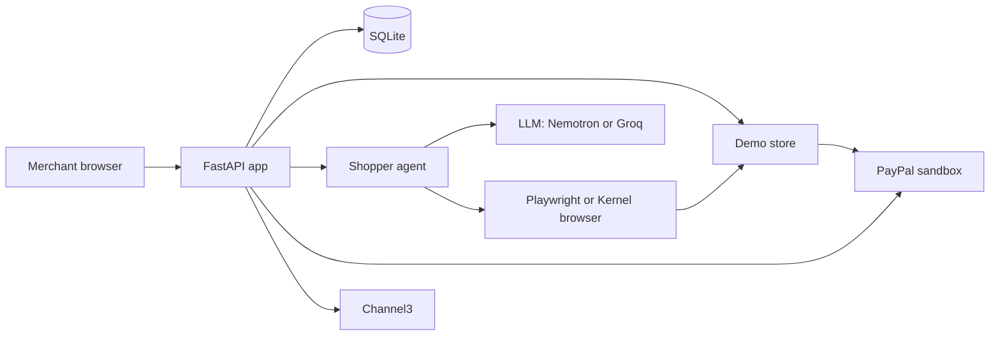

# TRD: GhostShopper

## Architecture

One FastAPI process (one Render free web service):

```
browser ──> FastAPI (backend/app/main.py)
              ├── /api/health
              ├── /api/paypal/orders, /orders/{id}/capture   Orders v2 (sandbox)
              ├── /api/runs ...            agent runs, steps, failures, scores (paged: limit, before)
              ├── /store/...               demo store (store/app.py, mounted sub-app)
              └── /                        dashboard build (D5/D6: frontend/dist)
SQLite file (DATABASE_PATH)
Shopper agent: LLM (configurable provider)  <->  tools  <->  Playwright (local) | Kernel browser (real runs)
```

Diagrams: [architecture.png](diagrams/architecture.png) (simplified) and [architecture-detailed.png](diagrams/architecture-detailed.png) (numbered steps). The simplified one again in Mermaid:



- `store/`: Fernhill Ceramics, a plain server-rendered shop (Jinja2). Flaw toggles in SQLite table `store_flaws`, edited at `/store/admin` or `PUT /store/admin/flaws.json`.
- `backend/`: API, PayPal client, agent (`backend/app/agent/`: `loop` tool-calling loop, `browser` Playwright tools, `checks` + `engine` deterministic detectors, `paypal_flow` checkout, `llm` provider layer and replay, `recorder` SQLite), `scoring` (pure).
- `PAYPAL_MODE=mock` swaps in `paypal_mock.py`: fake Orders client + mock v6 SDK/popup at `/mock-paypal/*`. Reported by `/api/health`. Default is `sandbox`.
- `frontend/`: React + Vite + TS, AG Grid Community. Dev server proxies `/api` and `/store` to :8000.

## Stack

Python 3.11+ (dev on 3.13), FastAPI, httpx, Jinja2, SQLite (stdlib `sqlite3`), pytest (+ anyio plugin for async tests). Node + Vite + React 19 + TypeScript. Playwright for Python; browsers installed inside the venv (`PLAYWRIGHT_BROWSERS_PATH=0`).

## External APIs

| API | Use | Notes |
|---|---|---|
| PayPal JS Web SDK v6 | Store's PayPal button | `https://www.sandbox.paypal.com/web-sdk/v6/core`; `paypal.createInstance({clientId, components:["paypal-payments"]})`, `findEligibleMethods`, `createPayPalOneTimePaymentSession({onApprove,onCancel,onError})`, `session.start({presentationMode:"auto"}, createOrderPromise)`. |
| PayPal Orders v2 | Server create + capture | `POST /v1/oauth2/token` (client credentials), `POST /v2/checkout/orders` (intent CAPTURE, items + breakdown), `POST /v2/checkout/orders/{id}/capture`. Fees from `captures[0].seller_receivable_breakdown`. Sandbox host hardcoded: `api-m.sandbox.paypal.com`. |
| LLM provider | Navigation and fix explanations | `ChatModel` base class in `agent/llm.py`. `OpenAICompatibleChat` covers NVIDIA Nemotron (primary, `https://integrate.api.nvidia.com/v1` with `LLM_PROVIDER=openai-compatible`), Groq (free tier, supported alternative), OpenAI, OpenRouter, Together, Ollama and any OpenAI-compatible URL. `AnthropicChat` translates to and from the Anthropic Messages API and sends no temperature or forced `tool_choice`. Providers are entries in `PROVIDERS`. Config: `LLM_PROVIDER`, `LLM_MODEL`, `LLM_API_KEY`, `LLM_BASE_URL`; `GROQ_API_KEY` and `GROQ_MODEL` still work. Missing config is an error. `--llm mock` replays cassettes. |
| Kernel | Hosted browser for real runs | Local Playwright in dev. Same tool layer, different browser factory. |
| Channel3 | Market check: similar products | D4. |

## Key technical rules

- The order amount is computed server-side from `store/products.json`; the browser only sends SKU + quantity.
- Capture only orders this server created (checked in SQLite).
- Missing credentials return explicit errors (503 `PAYPAL_NOT_CONFIGURED`, "PayPal is not configured" on the checkout page). No sample-data fallback.
- Failures are detected by deterministic checks in the tool layer, not by the LLM. The score is a pure function of the recorded failures and checkout result.

## Purchase trace

`GET /api/runs/{id}` carries a `trace` that compares five records of one purchase, field by field (product, quantity, amount, currency, status): what the agent wanted (run target and catalog price), the demo store's own order (`store_orders`), PayPal's order (the stored GET order response), PayPal's capture (the stored capture response) and what the store's order page shows afterwards. After a payment attempt the runtime opens that order page and records it as a step. A value a source does not expose is `unknown` with a reason, never filled in. The first disagreement is flagged, with a plain explanation and a fixed fix text. The builder is `backend/app/trace.py`. It does not touch the score, and no LLM is involved. Live stores only get `unknown` for the store's order, since the shopper cannot see it. The demo store keeps its own orders in `store_orders` (`store/orders.py`, order page `/store/orders/{n}`); four purchase flaws (`never_marks_paid`, `declined_marked_paid`, `success_after_cancel`, `duplicate_on_retry`) make the store's record disagree with PayPal's. The mock PayPal has `buyer_cancels` and `first_attempt_fails`, and the agent retries once on a temporary capture error.

## Prompt-injection guard

Store pages are untrusted input. The system prompt frames page content as data. `agent/injection.py` flags text aimed at AI agents (hidden or visible), and the findings are saved as `agent_safety` on the run. Hard limits hold whatever a page says: no other hosts, no downloads, no password or card fields. The store flaw `hidden_agent_instructions` demonstrates it. The guard never changes the score.

## Server behaviour

- SQLite uses WAL, `synchronous=NORMAL` and a 5 second busy timeout on every connection, with indexes listed in SCHEMA.md. One connection per request.
- Finished runs are cached in process (LRU of 128) and market checks for 10 minutes per SKU. Both assume one process, like the run lock and the rate limiter, so the app runs as a single instance.
- Responses over 1,000 bytes are gzipped. `/assets/*` is immutable for a year, `/api/rubric` is public for an hour, other `/api` responses are `private, no-store`.
- The demo store's settings unlock through a form at `/store/admin` that posts to `/store/admin/unlock` and sets an httpOnly, SameSite=Strict cookie. `X-Admin-Token` also works. A token in the URL is not accepted.

## Constraints

SQLite only. Free-tier LLM rate limits (Groq or the NVIDIA endpoint): keep runs under ~25 steps. PayPal sandbox only. AG Grid Community only. Render free tier (cold starts, ephemeral disk: the DB resets on redeploy, acceptable for a demo). Secrets only in `.env`.

## Scoring rubric

Rules version `2026-11-05.3`. The code in `backend/app/scoring.py` is the source of truth; this table should match it.

Every run records one outcome per check: pass, fail, excluded, or not tested. A failure's code (in `backend/app/failures.py`) says whether the store caused it. If it didn't (the buyer's bank declined, the browser blocked a popup, the run itself crashed), the check is excluded, and so is every check it stopped from running.

The score is `round_half_up(100 * earned / possible)`, where `possible` is 100 minus the points of excluded checks. Failed and untested checks earn nothing. If everything is excluded there's no score. A browse-only run (no payment) can reach 80 at most.

| Stage | Check | Points | Fails when |
|---|---|---|---|
| discover (5) | product_found | 5 | the agent never reached a page titled with the product |
| details (40) | price_in_text | 12 | there's no price text in `<main>`, e.g. it's only in an image |
| | currency_stated | 3 | a readable price has no currency, in the text or in JSON-LD |
| | structured_data | 12 | no Product JSON-LD, or it lacks name, price, priceCurrency or availability |
| | stock_readable | 4 | no stock status in the text or JSON-LD |
| | stock_consistent | 3 | the page says sold out but still offers a buy control |
| | image_alt_text | 3 | a product photo's alt is empty, a file name, or generic |
| | sale_claim_consistent | 3 | the "was" price or percent-off claim doesn't match the real price |
| checkout (30) | clear_buy_button | 10 | no real button or link labelled Buy, Add to cart or Checkout |
| | buy_button_unobstructed | 4 | something covers the buy control |
| | no_extra_steps | 6 | the agent had to fill a form between the product page and checkout |
| | checkout_reached | 6 | the agent never got to a checkout page with a payment button |
| | price_consistent | 4 | the checkout price differs from the product page price |
| payment (20) | paypal_button_found | 4 | no visible PayPal button |
| | popup_opened | 3 | no PayPal window; the store's fault if the click does nothing, the browser's if it blocked the popup |
| | payment_approved | 3 | login or approval didn't finish, a human check timed out, or someone cancelled (all excluded) |
| | capture_completed | 5 | capture error or no confirmation page (store); declined by the buyer's funding source (excluded) |
| | payment_verified | 5 | order vs advertised price, capture vs order, currency or capture id mismatch (store); pending capture or bad fee data from PayPal (excluded) |
| outcome (5) | task_completed | 5 | the agent gave up, looped, ran out of steps or kept timing out (store); stopped by something outside the store (excluded) |

If the agent never reaches the product page or checkout, product_found and checkout_reached fail. Later checks are marked not tested, or excluded when an environment failure is what stopped the run.

Fixes are listed failed first, then untested. task_completed goes after the failures that caused it, then by points, then by severity.
