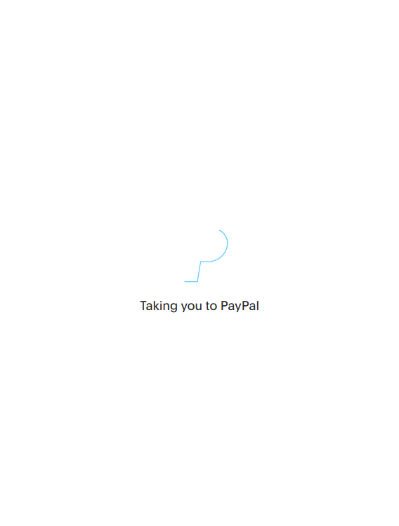
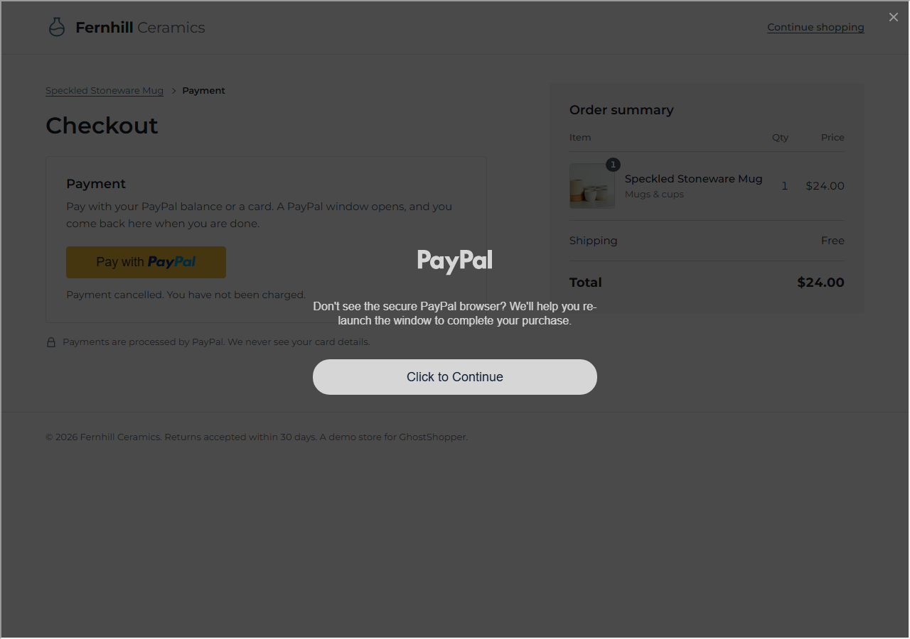
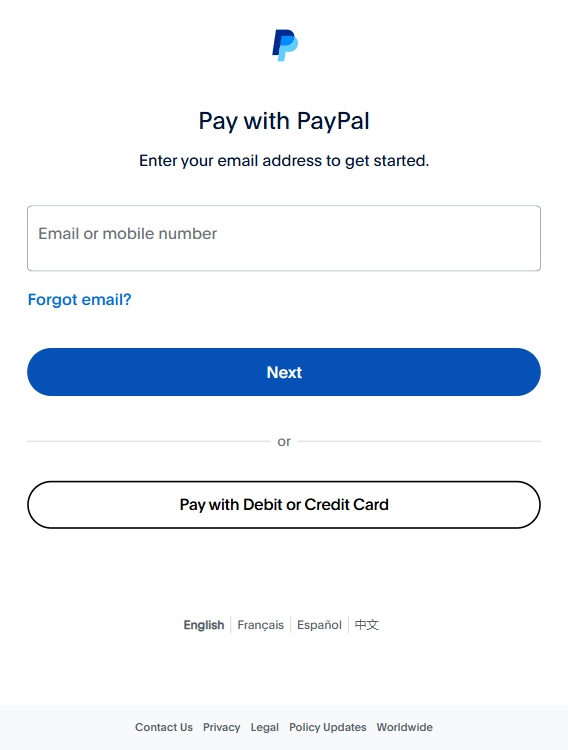
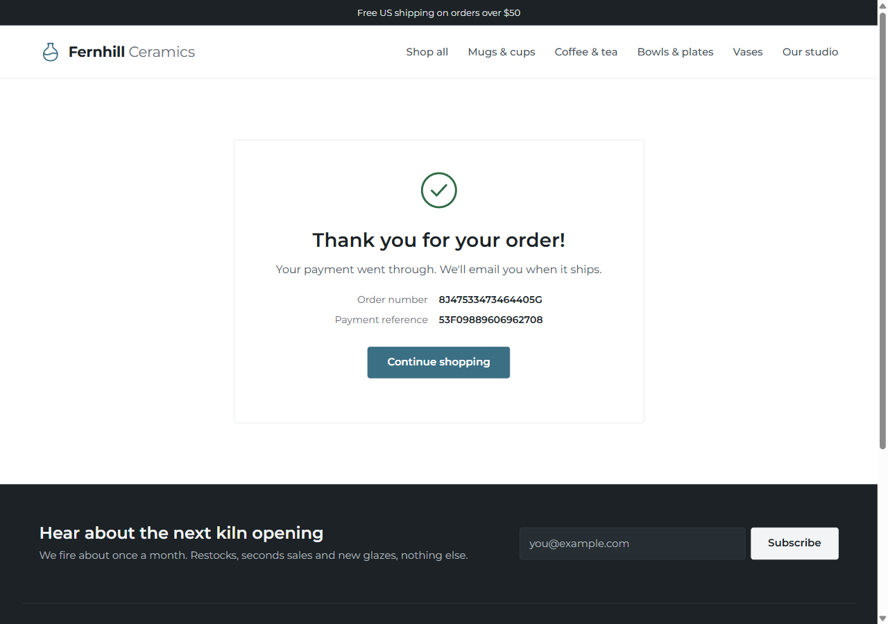

# Issues and fixes

What broke, why, and what we did about it. Newest first.

## 2026-11-11 (session 5)

### Diagram redraw stalled twice
Two subagent attempts ran about 20 minutes each without editing the file. Cause: the brief asked for a layout problem (no crossings) to be solved inside a large skill workflow. Fix: redrew it directly. The crossings came from the column order, so Pay flows moved next to the shopper loop and PayPal moved above the browser, with the Checkout to PayPal arrow routed round the right edge.

### README showed the old UI
The README screenshots were from Nov 7, before the Nov 10 redesign. Fix: cropped panels from today's full page captures of runs 30 and 34 into `docs/screenshots/2026-11-11/`, downscaled to 900 px.

### Banner arrow turned into mojibake
Rewriting the SVG with PowerShell 5 `Get-Content` read it as ANSI and broke the arrow character. Fix: the arrow is now the `&#8594;` entity.

## 2026-11-11 (security audit before the public deploy)

### Rate limits could be dodged with a forged X-Forwarded-For
The Dockerfile trusts every proxy (`--forwarded-allow-ips='*'`), and uvicorn then reports the leftmost X-Forwarded-For entry as the client address. That entry is whatever the caller wrote, so a fresh fake address and a fresh owner cookie on each request got past every limit (runs, market check, PayPal orders). Fix: the limiter reads the entry `TRUSTED_PROXY_HOPS` from the right (default 1, the one Render appended) and falls back to the socket address when the header is missing. Process-wide daily caps now sit behind the per-address limits (`RUN_DAILY_CAP` 40, `MARKET_DAILY_CAP` 100, `ORDER_DAILY_CAP` 100). A request with the presenter's unlock cookie skips both, so the single run slot can't lock the presenter out.

### Anyone could switch the mock PayPal scenario
`PUT /mock-paypal/scenario` had no check, so a visitor could make the shared fake PayPal fail for everyone. It now needs developer options or the unlock cookie, and answers 403 otherwise. The seed script, the trace benchmark and the e2e tests only call it with developer options on.

### Store fetches buffered whole responses and could be rebound
The preflight and robots.txt fetches read the entire body, so a huge page could use up the 512 MB instance. They now stream: robots.txt stops at 512 KB and the preflight reads no body. The SSRF check also resolved a name once and let httpx resolve it again, so a rebinding name could reach a private address. A pinned transport now resolves once, refuses the name if any address is private, and connects to that address with the original Host header and TLS name. The error for a store that answers with an error no longer includes the status code.

### Admin unlock had no throttle and a raw cookie
`POST /store/admin/unlock` allowed unlimited guesses and stored the token itself in the cookie. It is now limited to 10 attempts per 15 minutes per address, and the cookie holds an HMAC of the token (checked with a constant-time compare).

### Smaller items
A bad `max_amount` on the agent order endpoint raised an unhandled error (500); it is now a 422 `BAD_MAX_AMOUNT`. The Docker image runs as a non-root user, sets `DEV_OPTIONS=0`, skips the Chromium install unless built with `INSTALL_CHROMIUM=1`, and `backend/requirements.txt` is pinned to the versions in `.venv`.

## 2026-11-11 (session 4: live runs, Kernel)

### Live run stopped at config
`LLM_PROVIDER=nvidia` was unknown. Only `openai-compatible` plus a base URL was supported. Fix: an `nvidia` provider with the NVIDIA base URL.

### "Not tested: never reached the product page" on runs that reached it
The reason was a stage level fallback. Fix: per check reasons when the stage was reached (currency_stated, price_consistent, buy_button_unobstructed).

### Two pytest runs at once collided and hung
The agent started a second run while one was going. Fix: one run at a time, in the foreground with a timeout.

### Kernel run hung on Shopify
Run 36 hung about 8 minutes and was killed by hand. Shopify registers a service worker. Over CDP the context route handler received its requests, and in Playwright both the frame access and continue raise, so the requests were never resolved. Fix: service workers blocked locally and bypassed in Kernel (`Network.setBypassServiceWorker`), the request guard never raises, inactivity timeout 300 s, run limit 600 s, session always deleted on error, timeout, cancel or Ctrl+C. Run 37 finished in 19 steps. Run 36 still shows "running" in the local DB.

### Browser tests opened start.duckduckgo.com and failed
Error: "Only pages on 127.0.0.1 can be opened". `BROWSER_PROVIDER=kernel` in the developer's `.env` made tests use Kernel cloud browsers, which can't reach localhost. Fix: set `BROWSER_PROVIDER=local`, and the root `conftest.py` now forces local and blanks paid keys.

### Ledger: Transaction Search NOT_AUTHORIZED
The "Transaction search" feature was not enabled on the sandbox REST app. After enabling it PayPal took a while to add the scope, and the running server kept an old token. Fix: enable the feature, wait, restart the server. Rows for runs 18, 31, 32 and 34 now show matched.

### Trace benchmark miss: store order without a PayPal id
The trace guessed "never charged". Fix, by user decision: PayPal stages unknown plus the mismatch `paid_without_paypal_reference`. Benchmark is 33/33.

### Open: flaky matrix test
`test_trace_matrix` subset test failed twice under load, then passed in later full runs. Cause not verified.

## 2026-11-09, part 2 (ledger, flow cards)

### "Stopped at" pointed at a step the shopper got past
On the seeded bad store the screen said the shopper stopped at the product details. It actually got past that page and was blocked at the account wall in checkout. The cause was that we took the first failed stage as the stop point. Fix: the stop is the earliest failed step with no later step passing (`stopIndex` in `bits.tsx`), and earlier failures show as "Got past". Still open: the reason line names the first failed check in that stage, the ambiguous button, when it should name the account wall. That fix was interrupted (see PROGRESS.md).

### Ledger rows all "pending" after a restart in mock mode
Mock Transaction Search only knows captures held in server memory. A restart, or orders captured by the seed or the CLI, leave every row "pending", and Render restarts often. Planned fix: in mock mode, build the reporting rows from the captures in SQLite, for mock ids only. Interrupted, not done.

## 2026-11-09 (money hero, vault payment)

### The bad store still got paid, so the hero said Yes
The seeded "before" run on the bad store captured $24.00 in mock, and the new money headline said "Yes. Paid with PayPal". The cause: none of the four classic flaws actually blocks a purchase. They make the shopper's job harder, but it gets through. Fix: a paid run with failed checks now reads as at risk ("Our agent got through after N obstacles"). We also added a store flaw, `no_guest_checkout`: an account form with a password field and no PayPal button, off by default and not in the classic flaws. It fails `paypal_button_found` with `account_required`, and the LLM cannot get past it because of the password guard.

### The payment stops at PayPal's password page
In headless and real sandbox runs the shopper reaches PayPal's login and stops. Run 19 was the first evidence, and it is still what the user sees. A real AI shopping agent would not type a password either. Fix: vault payment. The buyer approves once, and the agent pays with the saved token through the store's `POST /api/paypal/agent-orders` (Orders v2 with `payment_source.paypal.vault_id`). Mock tests only so far. The real sandbox run is still to do.

## 2026-11-08 (blockers and audit fixes)

### A budget like 1E+30 returned 500 at run start
`parse_budget` quantized the value before it checked the size, so a huge exponent overflowed the decimal context. Fix: the maximum is checked first, and an overflow raises `RunConfigError` instead of an unhandled `ArithmeticError`.

### The refund route missed network errors and could refund twice
The route caught only `PayPalError`, so an httpx error or a malformed PayPal reply surfaced as a 500. A retry after a lost reply could also send a second refund. Fix: httpx errors return 502 `PAYPAL_UNREACHABLE`, malformed replies return 502 `PAYPAL_BAD_RESPONSE`, and the refund id is saved before the read-back. A retry reads the existing refund instead of creating another one. Errors are logged with PayPal's debug_id. `record_refund` refuses to overwrite a different refund id.

### Budget was read from the store page
`pay()` took the total from the page text. A `price_mismatch` flaw could push the real charge over budget, and a note like "Free shipping over $50" could block a purchase that was within budget. Fix: `pay()` reads the amount from the store's create-order response and refuses before approval if it is over budget (`over_budget`, environment). It waits up to 15 s for that response. The page total is kept only as evidence. An over-budget refusal leaves a CREATED order that is never approved.

### PayPal v6 component names were wrong
Venmo needs the `venmo-payments` component, and the card eligibility key was `basic_card` where the docs say `card`. The names had not been checked against the v6 docs. Fix: names checked against the PayPal docs (see `docs/research/paypal-v6-components.md`). Not yet tested in a browser. The Pay Later component name still conflicts between two doc pages, so ours stays.

### A comment in create_order was wrong
The comment said the PayPal request id was reused. Each call sends a fresh one. Only the comment changed.

### Left open from the audit (low)
- `GET /api/paypal/orders/{id}` and `/verify` have no owner check, because the agent calls them over HTTP without the owner cookie. The order ids are hard to guess, so the risk is low.
- The approve selectors are broad. They match more buttons than needed, which is a low risk on the sandbox page.

---

## 2026-11-07 (live test of the PayPal features)

### Run 20: the agent did not click Complete Purchase (hand-assisted)
The popup reached PayPal's review page (`sandbox.paypal.com/webapps/hermes`, a "Pay with" list and a Complete Purchase button at the bottom). The agent marked it `unknown_form`, handed over to a human, and the user clicked Complete Purchase by hand 4 min 40 s after the order was created. The payment then captured and verified, so the run counts as purchased but was not autonomous. Root cause: none of the `approve` selectors matched the hermes button as visible, and the page has radio inputs, so the state fell through to `unknown_form`. The real id was never confirmed (the old comment said unverified). Fix in `paypal_flow.py`: more approve selectors (`#consentButton`, test ids, a role and name match, input submit, role=button text), and `_click_first` now scrolls the button into view and uses a 5 s click timeout. Needs one live confirm in a later run; no extra PayPal run was spent on it.

### Run 19: headless run stuck at the password step
Through the API the browser is headless. The popup took the email but did not finish the password step, and the run failed `approval_timeout` after 120 s (environment, no points lost). Order 9M109243TS5211110 stayed CREATED. The API had no way to ask for a visible browser. Fix: a dev-only `headed` field on `POST /api/runs` (`runs.py`), refused on a deployed server like the other dev options. Headed runs got through.

### PayPal readiness said the button was only partly there
Run 20 clicked the PayPal button, yet readiness showed the button as "partial" (8/20) and "PayPal early in the path" as missing, so the figure was 28 and the panel advised "Make the PayPal button visible". Root cause: the page scan ran before the SDK drew the button, and the demo store's checkout never told the collector that the agent had seen it (only the live-store probe did). Fix: `paypal_flow.py` calls `engine.paypal.note_button` once the button is visible. Runs 20 and 21 keep the old figure because they ran before the fix. Not re-run live.

### Results page was wider than a phone
At 375 px the Simple view laid out 448 px wide and clipped text on the right (the headline, the money panel, the readiness bars). The page did not scroll sideways because the body clips overflow, so a scroll check said 0. Root cause: the grid in `Results.tsx` had no column template below `lg`, so one wide child stretched the single auto column. Fix: `grid-cols-1`. After the fix the content is 375 px wide.

### Not a bug: readiness tab screenshots
Full-page screenshots taken after clicking the PayPal readiness tab showed the Failures grid. The tab was selected and its panel had the right content; the capture was stale. The saved readiness tab images for runs 20 and 22 are panel only. The run 21 one is a full-page capture and may show Failures.

---

## 2026-11-07 (first real sandbox purchase)

### Run 14: the PayPal button was missing after 20 seconds
A headless run scored 75/100 with the store failure `paypal_button_missing`. A separate headless page load right after showed the button rendering fine, with no console errors. This looks like a slow first load of the v6 SDK. Not fixed. If it repeats, the button timeout should go up.

### Runs 15 and 16: approval timed out
The button was found and the popup opened, then both runs failed with "Approval did not complete within 120s (stuck waiting for the PayPal window to close)". The code was `approval_timeout` (environment), so the score stayed 100/100 on 82 of 100 points. A step-by-step headed script showed the sandbox login page loads fine, so the page itself was not the problem.

Watching the headed browser, the user saw PayPal's error page at `/checkoutweb/genericError` with the text "You are logging in to the account of the seller for this purchase". The `code` query parameter is base64 of the issue name and decoded to CANNOT_PAY_SELF. Root cause: `SANDBOX_BUYER_EMAIL` and `SANDBOX_BUYER_PASSWORD` in `.env` were the seller (business) sandbox account. Fix: use the personal sandbox account as the buyer.

### Run 17: stuck again, with a different error
With the buyer fixed, the headed run timed out the same way. The browser showed a generic PayPal page, "Things don't appear to be working at the moment". Its code decoded to UNSUPPORTED_PAY..., but the URL was cut off in the screenshot, so the full issue name is unknown. Root cause: the payee was the India business sandbox account (the developer account was created with country India), which can't take this payment. Fix: a new US business sandbox account, a new REST app linked to it, the new client ID and secret in `.env`, a US personal buyer, and a server restart because it reads the keys at startup.

### Run 18: it worked
Outcome purchased, readiness 100/100, nothing excluded. The order and capture numbers are in PROGRESS.md.

### The agent blamed a timeout for an account setup error
In all three stuck runs the failure said the approval timed out, when the real cause was on PayPal's error page. `paypal_flow.py` now polls for `/checkoutweb/genericError` after clicking approve, decodes the `code` into the issue name and fails `payment_approved` at once with `paypal_error_page` (environment, no points lost). CANNOT_PAY_SELF has its own hint: the buyer login is the seller's own account. `failures.py` and `plain.py` got the fix text and a plain "not your fault" line. The mock scenario `seller_login` and a unit test for decoding error-page URLs cover it.

## 2026-11-06 (store redesign)

### The bad-store e2e test gave up instead of reaching checkout
An earlier uncommitted redesign added extra header links, and `test_agent_e2e.py` ended with `gave_up` instead of `reached_checkout`. The mock-LLM cassettes click by element id (e1, e2, ...), and `FACTS_JS` in `browser.py` numbers elements in DOM order across the whole page. More header links meant every id after them moved. The new design keeps the header small and the checkout controls in a fixed order. After approval, the five hand-written cassettes got new ids for the shop pages only: home mug link e9 (was e5), product Buy now and Continue e10 (was e5), Go e12 (was e7).

### The fixed store scored 77 instead of 80
`test_fixed_store_passes_every_browse_check` failed on `stock_consistent`. The "You may also like" row on the mug page showed the sold-out espresso set with a "Sold out" badge, and the detector read that as the mug's own stock. Related products now skip sold-out items (`store/app.py`).

### The carafe photo was a blank wall
The wrong Unsplash photo id was picked from a contact sheet. The right one was downloaded and checked by eye.

### `/store/credits` returned `{"detail":"Not Found"}` and the new CSS looked missing
The local server ran without `--reload`, so it was serving old code, and the stylesheet link had a fixed `?v=8`. Restarting fixes the first. The link now carries the first 10 hex characters of the file's sha256, computed at startup in `store/app.py`.

### Phone and tablet layout problems
The phone nav row was cut off mid-word, the flawed button row wrapped the arrow onto its own line, and the tablet product and checkout pages were cramped in two columns. Phones now get a `
` menu, the buttons sit in a 2x2 grid, and product and checkout stack to one column below 900px.

### The footer signup could not be a `<button>`
`test_ambiguous_buttons_toggle` in `store/tests/test_store.py` asserts the flawed product page contains no `<button` at all. The signup is an `<input type="submit">`.

### A test run reported exit 0 with 13 failures
pytest was piped through `tail`, which hid its exit code. Later runs record pytest's own exit code.

## 2026-11-06 (robustness pass)

### Two starts could both pass the "already running" check
The check and the lock were separated by an await, so two requests arriving together both saw a free slot. The lock is now taken with no await after the check and released when the run's task ends.

### A start that timed out still ran a check
The client got an error after 30 seconds, but the task kept going and later produced a check nobody asked for. A timed-out start now cancels its task.

### LLM clients were never closed
Start validation and explain built a client and dropped it. They close it now. `prepare()` also builds the payment handler before the LLM, so a payment error can't leave an open client behind.

### Anyone could rewrite an example's fix text
Explain on a shared example check was open to every visitor, so one person could replace the example's wording and spend the server's LLM quota. It answers 403 now.

### The admin token ended up in logs and history
Passing the token in the `/store/admin` URL put it in access logs and the browser history. The URL form is gone. The page shows a plain unlock form that posts to `/store/admin/unlock` and sets an httpOnly, SameSite=Strict cookie. The `X-Admin-Token` header still works.

### Concurrent writers could fail with "database is locked"
Each connection used the default journal mode and no wait for a busy database. Every connection, the store's included, now uses WAL, `synchronous=NORMAL` and a 5 second busy timeout.

### Ownership checks built the whole run
File, delete and explain loaded the full run payload to see who owned it. They read the owner column only now.

### The failures table drew huge or clipped rows
AG Grid sets each cell's line height to the row height, so wrapped text spread out. Every column now forces normal leading and the same top padding (`CELL` in `FailuresGrid.tsx`). The Technical fix column hides under 900px so Evidence stays in view.

## 2026-11-06 (the Ledger redesign)

### The failures table hid the evidence
Seven columns with minimum widths of about 1,245px sat in a 1,120px space, so every text cell was cut off and the Evidence column was off screen. The selector moved into the technical fix's tooltip and the developer report, and the table lists only real store issues, so its count matches the tab.

### "What the shopper did" ended before the purchase
It kept the first seven lines that weren't neutral, and four problem lines at the same step pushed out the payment. It now keeps the key moments and always the last line.

### The Live screen screenshot showed an empty feed
The capture ran before the first feed line arrived. Captures now wait for at least four lines.

### A favicon 404 on every page
The browser asks for `/favicon.ico`. The page now carries an inline SVG icon.

## 2026-11-06 (checks belong to a browser)

### Anyone could open anyone's check
Run ids count up from 1 and every run endpoint answered for any id, so changing the number in the link showed another store's results, screenshots and developer report. Runs now carry the hash of the starting browser's cookie token, and every endpoint returns 404 for a run that isn't yours or a shared example.

### "Before and after" showed the demo store to everyone
It compared the last two finished runs in the whole database, whoever ran them. It now compares a check with the previous check of the same store from the same browser.

### Public callers could change server state through developer options
`POST /api/runs` accepted `record` (writes a file on the server), `flaws` (changes the shared demo store) and the rest. A deployed server now refuses everything except `store_url`.

### Iframes and images on a checked page could reach internal addresses
The browser guard only checked main-page loads, so a hostile page could frame an internal address and our screenshot would show it. Every request's host is checked now, and every redirect hop of the server's own fetches too.

### Old runs would have turned public after the migration
A NULL owner means "shared example", and the new column starts as NULL. The migration marks existing runs `unclaimed` instead, which hides them from the web and keeps them out of the retention purge.

### The not-found screen said the server was down
The frontend matched the old error wording ("No such run"). It now checks the HTTP status.

## 2026-11-06 (dashboard)

### The stage bars showed full marks on a 49 run
The scorecard only sent points earned per stage, so the chart had nothing to compare them with and fell back to earned as the maximum. The scorecard now sends `stage_possible` (stage total minus excluded points).

### AG Grid rows didn't wrap and left a gap under the table
With `wrapText` and `autoHeight`, the grid measured row heights before the flex columns reached their final widths. Rows stayed short and the page kept the extra height. Cells are now one line at 44px with the full text in a tooltip.

### "Check my store again" shrank to a thin bar on phones
`flex-1` in a column layout sets the height basis to 0. It's `sm:flex-1` now, so it only grows in the desktop row.

### The gauge caption sat on top of the arc
The caption was positioned inside the half ring. It sits under the gauge now, and only the number stays inside.

## 2026-11-05 (Day 5 session)

### Cart detection swallowed the demo store's extra step
The new rule "a page under /checkout is checkout" matched the demo store's details form at `/store/checkout/details`. Checkout looked reached before the form, so no_extra_steps passed on the bad store and two end-to-end tests failed. Only the last path segment counts now: `/checkout` is checkout, `/checkout/details` isn't.

### The scripted navigator always started at /store/
On any other site that's a 404 page, and platform detection locked in "unknown" from it. Live runs now start at `/`, and detection keeps looking until a page shows its platform.

### A store without PayPal never reached checkout
The cart page had no payment button and wasn't titled "Checkout", so the missing PayPal button was never reported. Cart and checkout pages are now also recognised by their title ("Your cart") or path, and on live stores the PayPal check stays "not tested" if the cart is never reached.

### robots.txt refusals were silent on clicks
When a click led to a disallowed page, the browser blocked the load but the step still looked successful. The click tool now says the page wasn't opened and why.

### The decision page closed unanswered
The Impeccable decision page went away after its second round. I asked through the question tool instead.

## 2026-11-05 (tasks 1-11)

### The summary check outranked its own cause
With PayPal not rendering, the first fix on the scorecard was task_completed ("fix the failures above"), worth 5 points, ahead of the actual cause, paypal_button_found at 4. The ordering was points first. Now the outcome stage always sorts after the failures, and there's a unit test for it.

### Loop detection would have stopped legitimate exploration
Trying the ambiguous buttons one by one means going back to the product page and listing its controls again. Under the first version of the loop detector, that counted as the same action three times in eight steps and the run would have been stopped. We spotted it while writing the scripted navigator, before any run hit it. The window now resets whenever the page changes.

### Two bash heredocs wouldn't parse
Two long multi-file edit scripts failed with "unexpected EOF while looking for matching `''", and nothing was written. We redid both with the file tools.

### PowerShell piping added a BOM
Piping `python -m backend.app.eval judge` into another Python process from PowerShell prefixed a UTF-8 BOM, and `json.load` refused it. The judge itself had already run, so its ratings were saved twice. We left both rows, since nothing gets deleted, and re-ran the summary through bash.

### New checks changed the flawed-store scores
After adding the six new checks and reweighting, the classic bad store scored 29 instead of 20 in browse runs and 49 instead of 40 in checkout runs. It passes the new checks its flaws don't affect. That's expected, and the end-to-end tests now pin the new numbers with the arithmetic in a comment.

### Old tests assumed exactly four flaws and four product checks
Three tests compared whole dicts. These were spec changes rather than regressions, so we updated the tests to build the expected values from the flaw list.

## 2026-11-05 (Days 2-3)

### Playwright wanted to download browsers outside the workspace
By default, `playwright install` writes to `%LOCALAPPDATA%\ms-playwright`. We install and run with `PLAYWRIGHT_BROWSERS_PATH=0`, which keeps the browsers inside `.venv`, and `agent/browser.py` sets that by default. While the headless shell was still downloading, `PLAYWRIGHT_CHANNEL=chromium` ran the full build headless.

### The agent can't read `.env`
This is by design: the agent isn't allowed to see secrets. Groq status came from `/api/health` (`groq_configured`), which only reports whether a key is set. For the Day 2 runs we started the server with `PAYPAL_CLIENT_ID=" "` in the process environment, not in `.env`, so no page loaded the real PayPal SDK.

### Buy-button evidence selector was longer than the test expected
The test wanted `div.act.act-a`; the evidence held `div.product > div.product-info > div.actions > div.act.act-a`. The full path is better evidence, so the test now checks the suffix.

### `<paypal-button>` showed up with an empty label
`find_elements` printed `e4 paypal-button ''`, so an agent couldn't tell what the element was. `innerText` doesn't see into shadow DOM, which is where web components put their text. The name now falls back to the open shadow root's text, then to the tag name ("paypal button").

### The health test pinned the exact JSON
The Day 1 `test_health` broke once we added `groq_configured` and `paypal_mode`. It now checks the stable keys and the type of the new ones.

### The mock popup opens as about:blank first
We could have recorded the popup's URL and screenshot before the SDK pointed it at the PayPal page. The flow now waits for the popup to leave `about:blank` first.

### PowerShell `Remove-Item Env:...` was denied
The no-deletion rule covers it, and we didn't need it anyway: each shell call starts with a clean environment.

## 2026-11-05 (Day 1)

### pytest couldn't create temp dirs
Every test using `tmp_path` failed with `PermissionError: [WinError 5] Access is denied: ...\Temp\pytest-of-shiba`. This sandboxed Windows setup won't let pytest use its shared temp folder, but a fresh `tempfile.mkdtemp()` folder works. The root `conftest.py` overrides `tmp_path` to do that, and nothing is deleted automatically.

### A Jinja macro wasn't visible in child templates
We caught this before running anything: `price()` was defined in `base.html`, but templates that extend it can't call it. Child templates only override blocks; the parent's top-level macros aren't exported. The macro moved to `store/templates/_macros.html` and is imported with ``.

### Two test assertions were too strict
`"FH-MUG-01" not in html` failed because the SKU is in the buy URL, and `'class="act' not in html` matched `class="actions"`. The store was behaving correctly. The tests now look for the `SKU:` and `In stock` text, and for `'class="act '` with a trailing space.
